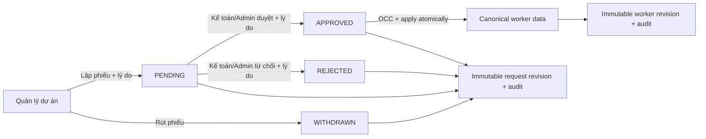

# P2.5 — Worker ownership, project authority và audited change control

> **Status:** `P2.5_PLAN_REUSE_SURVEY_READY_FOR_IMPLEMENTATION`
>
> **Baseline khảo sát:** `origin/main@a74caa3cfcbe8e91096ed905ca53b55715962a2c`, 43 migrations.
>
> **Cảnh báo:** P2.5 là contract-bump giữa P2 và P3. Không được đổi nghĩa `own` hiện tại, mở rộng quyền bằng UI-only check, hoặc dùng vai trò `reviewer` thay cho Kế toán.

P2.5 bổ sung quyền xem NLĐ theo người tuyển, quyền đề nghị thay đổi theo quản lý dự án, luồng Kế toán/Admin duyệt có audit bất biến, và quản trị dự án nhiều quản lý. P2.5 tái sử dụng Direct Entry, change request, revision/audit và capability system hiện có; không tạo một ứng dụng quản trị hay RBAC engine thứ hai.

## 1. Mục tiêu và Definition of Done

P2.5 hoàn thành khi:

- Mỗi nhân viên tuyển dụng xem được NLĐ có `direct_entries.recruiter_id` thuộc recruiter đã liên kết với tài khoản của mình, không phụ thuộc ai tạo/import dòng.
- Mỗi quản lý dự án xem được NLĐ thuộc các dự án đang được gán cho mình.
- Quản lý dự án không thể sửa trực tiếp dữ liệu canonical và không thể đề nghị thay đổi các field được bảo vệ (`*`).
- Quản lý dự án có thể lập phiếu thay đổi cho field không `*` và trạng thái `UNCONFIRMED` / `ON` / `OFF`; dữ liệu chỉ đổi sau khi Kế toán hoặc Admin duyệt.
- Cả người đề nghị và người duyệt/từ chối đều phải ghi lý do; hệ thống lưu actor, thời gian, before/after, version và kết quả trong log bất biến.
- Kế toán/Admin có thể sửa trực tiếp thông tin NLĐ trong phạm vi quyền của mình, nhưng luôn phải ghi lý do và tạo revision/audit.
- Kế toán/Admin có thể tạo, đổi tên, ngừng sử dụng dự án và gán/hủy gán nhiều quản lý cho một dự án.
- Mọi mutation đi qua server-authorized `SECURITY DEFINER` RPC; không cấp raw table DML cho browser, `authenticated` hoặc operator thông thường.
- Allowed/denied tests, migration tests, regression Direct Entry và Owner UI UAT đều đạt; không tuyên bố P2.5 PASS trước J01.

## 2. Quyết định nghiệp vụ đã khóa

### 2.1. Ba quan hệ không được trộn

| Quan hệ | Source of truth | Ý nghĩa |
|---|---|---|
| Người nhập | `direct_entries.created_by_user_id` | Audit nguồn tạo/import; không quyết định ai đã tuyển NLĐ |
| Người tuyển | `direct_entries.recruiter_id` + verified `direct_entry_app_user_recruiter_links` | Quyết định danh sách NLĐ của nhân viên tuyển dụng |
| Quản lý dự án | assignment đang hiệu lực giữa project và recruiter | Quyết định quyền xem NLĐ trong dự án và quyền lập phiếu thay đổi |

Team leader, recruiter và project manager là ba khái niệm độc lập. Một người có thể đồng thời giữ nhiều quan hệ, nhưng không được suy quyền quản lý dự án từ chức vụ `TEAM_LEADER` hoặc team membership.

### 2.2. Field được bảo vệ

Nguồn field phải là registry dùng chung cho server validation và UI; dấu `*` chỉ là cách render từ metadata, không phải authority.

Danh sách bảo vệ ban đầu:

- `employee_code`: server-owned, luôn bảo vệ.
- `project_id`, `first_work_date`, `display_name`, `recruiter_id`, `labor_type`: các field persisted bắt buộc đang được đánh dấu `*` trong Direct Entry.
- `provider_type` và `team_id`: dữ liệu dẫn xuất từ recruiter/effective date; không phải field để quản lý dự án tự sửa.

Quản lý dự án không được đổi các field trên, kể cả bằng request giả mạo trực tiếp tới API/RPC. Kế toán/Admin dùng privileged correction riêng, bắt buộc reason, OCC và audit.

### 2.3. Field quản lý dự án được đề nghị thay đổi

Trong dự án đang được gán, quản lý được lập phiếu cho:

- `gender`, `date_of_birth`, `national_id`, `national_id_issued_at`, `national_id_issued_place`, `address`, `phone`;
- `general_note`;
- payment fields hiện có trong contract;
- trạng thái làm việc, ngày hiệu lực và lý do nghỉ tương ứng.

Tài liệu/file upload tiếp tục dùng document capability và versioning hiện có; P2.5 không ngầm mở quyền tài liệu chỉ vì một người là quản lý dự án.

`SUBMITTED` là trạng thái tối thiểu để lập phiếu. Phiếu không làm thay đổi canonical data trước approval.

### 2.4. Luồng quyết định

- Người đề nghị không được duyệt phiếu của chính mình.
- Một request nhiều item là all-or-nothing; một item stale/denied làm cả transaction thất bại.
- Approval phải kiểm tra lại quyền, assignment đang hiệu lực, protected-field allowlist và expected version ngay trong transaction.
- Admin/Kế toán sửa trực tiếp dùng đường privileged riêng; không giả lập self-approval.

### 2.5. Project lifecycle và nhiều quản lý

- Một dự án có từ 0 đến nhiều quản lý đang hiệu lực.
- Gán/hủy gán có effective interval, actor và reason; hủy gán đóng hiệu lực thay vì xóa lịch sử.
- “Xóa dự án” trên UI là deactivate/soft delete. Dự án đã từng được NLĐ tham chiếu không hard-delete.
- Dự án inactive không xuất hiện trong lựa chọn tạo mới, nhưng dữ liệu lịch sử và reporting vẫn giữ nguyên.
- AP/TSCO hoặc dự án chưa có quản lý tiếp tục fail-closed với tài khoản HRP; Kế toán/Admin có all-scope authority.

## 3. Ma trận quyền P2.5

| Actor | Xem NLĐ | Lập phiếu non-`*`/status | Duyệt phiếu | Sửa trực tiếp | Quản trị dự án/assignment |
|---|---|---:|---:|---:|---:|
| Recruiter | NLĐ có cùng canonical `recruiter_id` | Chỉ khi đồng thời là quản lý project của NLĐ | Không | Không | Không |
| Project manager | NLĐ thuộc project assignment đang hiệu lực | Có | Không | Không | Không |
| Kế toán | Tất cả | Không bắt buộc; dùng privileged correction | Có | Có, bắt buộc reason/audit | Có |
| Admin/Owner | Tất cả | Có nhưng không tự duyệt | Có | Có, bắt buộc reason/audit | Có |
| Reviewer hiện tại | Giữ nguyên policy C01-R2 | Giữ nguyên | Giữ nguyên, không biến thành Kế toán | Không | Không |
| Reader/BoD | Reporting theo scope | Không | Không | Không | Không |

Kế toán là bundle thứ sáu trong policy contract, không phải alias của `reviewer`. Mặc định tái sử dụng capability hiện có với `all` scope:

- `entry_admin`, `entry_privileged_edit`, `entry_restore`;
- `change_review`, `employment_status.review`, `employment_status.apply`;
- `payment_view`, `payment_edit`, `document_view`, `document_upload`;
- `pii_view`, `audit_view`.

Kế toán không mặc định nhận `pii_export`, `recruiter_master_manage` hoặc `team_master_manage`. Project CRUD/assignment dùng `entry_admin@all`; full Admin surface vẫn yêu cầu AND của `entry_admin` + `recruiter_master_manage` + `team_master_manage`.

## 4. Schema và server boundary

### 4.1. Recruiter/project worker read model

Thêm RPC/projection tối thiểu, không expose raw table:

- Recruiter audience: verified app-user/recruiter link → `direct_entries.recruiter_id`.
- Project-manager audience: verified link → assignment đang hiệu lực → `direct_entries.project_id`.
- Kế toán/Admin: `entry_admin@all`.
- Projection field-sensitive: chỉ trả PII/payment/document metadata khi actor có capability tương ứng.
- Pagination, stable ordering và bounded filters ở DB/server boundary; không fetch tất cả rồi ẩn ở client.

Không đổi nghĩa creator-centric của các RPC draft/submission cũ. Worker directory là contract mới với audience predicate riêng.

### 4.2. Multi-manager assignments

Migration expand bảng assignment hiện tại từ một manager/project sang history model:

- `assignment_id uuid` làm primary key;
- `project_id`, `manager_recruiter_id`;
- `valid_from`, `valid_to` theo half-open interval `[valid_from, valid_to)`;
- unique active assignment cho cùng `(project_id, manager_recruiter_id)`;
- index theo project và manager cho current lookup;
- backfill assignment hiện có, không mất project scope đang chạy.

`direct_entry_actor_can_access_project` chuyển từ equality trên một row sang `exists` trong assignment đang hiệu lực. Catalog và full-profile write guard tiếp tục gọi helper này.

### 4.3. Project mutations

RPC đề xuất:

- `direct_entry_create_project`
- `direct_entry_update_project`
- `direct_entry_deactivate_project`
- `direct_entry_assign_project_manager`
- `direct_entry_unassign_project_manager`

Mọi RPC yêu cầu actor mapping, `entry_admin@all`, reason, idempotency key và expected version khi cập nhật. Dùng advisory lock hoặc row lock phù hợp; không last-write-wins.

Tái sử dụng `direct_entry_restricted_reasons` và `direct_entry_audit_events`. Thêm project revision append-only tối thiểu để giữ before/after của project; assignment history tự giữ interval và vẫn phát audit event.

### 4.4. Change request extension

Không tạo workflow mới. Mở rộng các boundary hiện có:

- Create: project manager predicate thay cho creator/team predicate khi audience là manager.
- Validate: deny mọi protected-field delta; `worker_details.display_name` phải giữ nguyên.
- Apply: approval path kiểm tra lại assignment và protected fields trước mutation.
- `general_note` và full worker-profile optional fields được bổ sung vào strict proposal projection.
- Existing payment và `WORK_STATUS` target kinds được tái sử dụng.
- Review projection chỉ lộ field theo capability của Kế toán/Admin; không log raw PII/payment.

## 5. Kế hoạch thực thi và gates

### P2.5-W01 — Baseline và policy contract

- **Owner đề xuất:** T1C read-only review; T0 khóa contract.
- **Việc làm:** inventory Production read-only; amendment C01-R2 cho Accounting, recruiter/project audiences, protected fields và project authority.
- **Gate:** không có field/quyền mơ hồ; reviewer/reader/owner invariants giữ nguyên; không code runtime.

### P2.5-W02 — Multi-manager và project master DB

- **Owner đề xuất:** T1B.
- **Việc làm:** migration expand/backfill assignment; project revision/audit; project CRUD và assign/unassign RPC; grants fail-closed.
- **Gate:** migration từ 43-current áp dụng clean; nhiều manager/project hoạt động; unassign giữ history; raw DML bị chặn.

### P2.5-W03 — Worker directory theo recruiter/project

- **Owner đề xuất:** T1B.
- **Việc làm:** server/RPC projection, pagination/filter; recruiter audience theo `recruiter_id`; manager audience theo assignment; Accounting/Admin all.
- **Gate:** không dùng `created_by_user_id` làm recruiter ownership; không fetch-all/hide-client; PII/payment projection đúng capability.

### P2.5-W04 — Project-manager change requests

- **Owner đề xuất:** T1B backend, sau đó T1A UI.
- **Việc làm:** mở rộng create/read/review/apply contracts; protected-field guard; non-`*` worker/payment/status proposal; reason/OCC/idempotency/audit.
- **Gate:** forged protected-field proposal bị DB từ chối; approval atomically apply; stale request không partial apply.

### P2.5-W05 — Accounting/Admin bundle và UI duyệt

- **Owner đề xuất:** T1B grants/server, T1A UI.
- **Việc làm:** seed/migration bundle Kế toán; reviewer list/detail; approve/reject; privileged correction; audit viewer tối thiểu.
- **Gate:** Accounting không có recruiter/team/user master quyền; Admin authority triple không bị nới; proposer không self-approve.

### P2.5-W06 — Worker và project operations UI

- **Owner đề xuất:** T1A.
- **Việc làm:** worker list theo audience; worker detail; request form chỉ cho non-`*`; status form; project CRUD; multi-manager picker; mobile/accessibility.
- **Gate:** server response là authority; UI ẩn/disable chỉ là UX; cùng component/registry cho desktop-mobile; không tạo grid/form framework mới.

### P2.5-I01 — Combined integration

- **Owner đề xuất:** một lane integration riêng sau khi W02–W06 xanh.
- **Việc làm:** cherry-pick linear, giải conflict, canonical test registration, migration dry-run, build.
- **Gate:** migrations cũ byte-identical; lockfile không đổi; `origin/main` chưa push/deploy ở task này.

### P2.5-J01 — Production verification và Owner UAT

- Controlled migration apply và deploy.
- Read-only count/scope verification trước và sau apply.
- Owner UAT cho recruiter roster, multi-manager, protected fields, request/approval, direct correction và project deactivate.
- Chỉ T0 sau UAT mới tuyên bố P2.5 PASS.

## 6. Acceptance bắt buộc

| ID | Ca kiểm thử | Kết quả bắt buộc |
|---|---|---|
| A01 | Actor B nhập NLĐ nhưng `recruiter_id=A` | A thấy NLĐ; B không được coi là recruiter owner chỉ vì đã nhập |
| A02 | Hai recruiter khác nhau | Không đọc chéo worker list |
| A03 | Hai manager cùng một project | Cả hai thấy worker và lập được phiếu |
| A04 | Manager không thuộc project | List/detail/create-request đều fail-closed |
| A05 | Manager đổi field `*` bằng UI/API/RPC giả mạo | Bị từ chối, canonical data không đổi |
| A06 | Manager đổi field non-`*` | Phiếu PENDING; canonical data chưa đổi |
| A07 | Manager đề nghị ON/OFF | Chỉ đổi sau Accounting/Admin approval |
| A08 | Approve với expected version stale | Conflict; không item nào được apply |
| A09 | Proposer tự approve | Bị từ chối |
| A10 | Accounting approve/reject | Bắt buộc reason; request + worker revision/audit đầy đủ |
| A11 | Accounting/Admin direct correction | Bắt buộc reason; before/after và actor/time bất biến |
| A12 | Reviewer hiện tại xem payment | Vẫn bị deny theo D-1 |
| A13 | Gán manager thứ hai | Không thay manager thứ nhất; cả hai effective |
| A14 | Unassign manager | Quyền mới bị thu hồi; lịch sử assignment còn |
| A15 | Deactivate project | Không chọn cho entry mới; worker/report lịch sử không mất |
| A16 | Replay cùng idempotency key/payload | Trả kết quả cũ; không nhân revision/audit |
| A17 | Replay key khác payload | Conflict, không mutate |
| A18 | Browser gọi raw table/RPC thiếu quyền | Deny; không lộ PII/payment/reason raw |
| A19 | Desktop/mobile/a11y | Cùng authority và actions; keyboard/focus hoạt động |
| A20 | Direct Entry/reporting/team dashboard regression | Không đổi aggregate, catalog và scope hiện có |

## 7. Reuse bắt buộc và dependency policy

| Nhu cầu | Tái sử dụng | Delta tối thiểu |
|---|---|---|
| Auth/session | `resolveActorForRequest`, Supabase SSR, actor repository | Thêm audience/project predicate; không auth framework mới |
| Capability/scope | 21-token v2 set, grants, `direct_entry_assert_*` | Accounting preset + policy amendment; không role engine mới |
| Required/protected fields | `WORKER_PROFILE_FIELDS`, `DirectEntryGridColumn.required` | Thêm metadata protected-after-submit dùng chung UI/server |
| Request lifecycle | change-request tables, APIs, repositories, proposer/reviewer UI | Mở audience và strict field allowlist |
| Approval/application | `direct_entry_decide_change_request`, `direct_entry_apply_change_item` | Re-check project assignment/protected fields; general note/full optional profile |
| Audit/revision | restricted reasons, revisions, audit events, immutable triggers | Project revision tối thiểu; không event-sourcing framework mới |
| Employment status | existing events/RPC/projection, `WORK_STATUS` target | Route manager qua request; Accounting/Admin apply |
| Project scope | W07B assignment table/helper/catalog/write guard | Expand one-to-many + effective history |
| Project data | `direct_entry_projects` và catalog projection | CRUD/deactivate/version RPC |
| UI | AppShell registry, React Data Grid, Radix Dialog, existing forms | Worker/project operations pages; không component library mới |
| Validation | Zod + current strict projectors/allowlists | New schemas only |
| Tests | `node:test`, PGlite, existing DB fixtures and canonical scripts | Targeted suites wired once into `pnpm test` |

Không thêm ORM, state manager, workflow engine, audit library, RBAC library, form library hoặc grid package. Không thêm dependency nếu một gap được chứng minh bằng source survey và T0 duyệt.

### 7.1. Evidence → Finding → Path

| Evidence | Finding | Implementation path |
|---|---|---|
| [`20261002170000_p1_6_direct_entry_foundation.sql`](../supabase/migrations/20261002170000_p1_6_direct_entry_foundation.sql) | Request state, reason, OCC/idempotency, apply, revision và immutable audit đã tồn tại | Mở rộng predicate/allowlist; không viết workflow duyệt mới |
| `origin/main:supabase/migrations/20261008020000_p3_w07b_project_manager_scope.sql` | Project scope đã fail-closed nhưng schema chỉ cho một manager/project | Expand assignment history và giữ helper/catalog/write guard |
| [`worker-profile-import-contract.ts`](../src/lib/direct-entry/worker-profile-import-contract.ts) + [`direct-entry-grid-columns.ts`](../src/lib/direct-entry/direct-entry-grid-columns.ts) | Required metadata đã sinh cột/dấu `*`, nhưng chưa có protected-after-submit contract | Thêm một metadata dùng chung; server vẫn là authority |
| [`change-request-repository.ts`](../src/lib/direct-entry/change-request-repository.ts) + [`change-request-reviewer.ts`](../src/lib/direct-entry/change-request-reviewer.ts) | API/repository/proposer/reviewer đã có strict projection và sanitized errors | Bổ sung non-`*` profile/general-note/project audience vào cùng surface |
| `origin/main:src/lib/navigation/registry-capability.ts` | Nav registry và admin triple đã có; `finance` hiện fail-closed | Thêm Accounting/project-operations predicate trong registry hiện tại |
| [`package.json`](../package.json) | Next/React/Supabase/Zod/RDG/Radix/PGlite đã đủ | Không thêm runtime dependency |

Ước lượng kỹ thuật: tái sử dụng khoảng 60–70% runtime/backend flow so với xây mới; phần code mới tập trung ở multi-manager/project CRUD, audience queries và UI operations. Đây là ước lượng kiến trúc, không phải số LOC nghiệm thu.

## 8. Cutover, rollback và tài liệu

- Expand/backfill/verify/switch; không sửa byte migrations #1–#43.
- Backfill assignment hiện tại thành interval đang mở; đối soát số project/manager trước-sau.
- Seed Accounting grants chỉ cho account Owner đã xác nhận; không suy từ email hoặc role name client gửi lên.
- Nếu rollout lỗi, tắt nav/routes mới và revert runtime; migration expand giữ tương thích với helper cũ cho tới khi rollback hoàn tất.
- Không rollback bằng cách xóa audit/revision/assignment history đã phát sinh.
- `DOC_BUDGET=DELTA_ONLY` cho W01–W06; mỗi handoff tối đa 40–60 dòng. I01/J01 có đúng một release record tổng hợp.

## 9. Checklist đóng P2.5

- [ ] Policy matrix amendment khóa Accounting, project authority và protected fields.
- [ ] Recruiter list dựa trên `recruiter_id`, không dựa trên creator.
- [ ] Multi-manager effective history và project CRUD/deactivate được áp dụng.
- [ ] Project manager chỉ submit non-`*`/status request; không direct mutation.
- [ ] Accounting/Admin approval và direct correction đều có reason, OCC, idempotency và immutable audit.
- [ ] PII/payment/document projection fail-closed theo capability.
- [ ] A01–A20 có expected/actual và không còn blocker.
- [ ] Migration ledger, canonical tests, build, security/docs gates xanh.
- [ ] Production read-only verification và Owner UI UAT đạt.
- [ ] Chỉ T0 tuyên bố `P2.5_PASS`; P3 scoped reporting/team dashboard tiếp tục theo roadmap riêng.

## 10. Phase kế tiếp đã khóa

Sau khi P2, P3 và P2.5 hoàn tất, roadmap tiếp tục theo thứ tự:

| Phase | Phạm vi | Thời điểm |
|---|---|---|
| P3.1 | [Full User/Catalog Admin](./P3.1.md) | Làm ngay sau combined P2/P3/P2.5 closure |
| P3.2 | Account security nâng cao | Sau P3.1 |
| P3.3 | AI Production activation + operational hardening | Sau P3.2, trừ hotfix vận hành khẩn cấp |

P3.1 gồm quản lý account hiện có (enable/disable, grants/scopes, recruiter links), team membership, onboarding/offboarding, full audit explorer, `entry_restore`, `pii_export` nếu Owner duyệt, và quản trị recruiter/team/project/vendor đầy đủ. Admin và Kế toán đều vận hành business catalog; chỉ Admin quản lý account/grants/scopes/links. Nhân sự catalog có thể chưa có account và có thể chưa được phân team. Việc tạo/invite account thật vẫn thuộc P3.2.

Ranh giới không được trộn: P2.5 cung cấp project CRUD/multi-manager tối thiểu cho vận hành NLĐ; P3.1 mở rộng thành Admin UI và catalog lifecycle toàn diện. Quyền catalog mở rộng của Kế toán chỉ có hiệu lực sau policy contract-bump P3.1-C01, không hồi tố làm thay đổi bundle Kế toán tối thiểu của P2.5.

P3.2 gồm invite/account creation UI, forced password reset, Admin reset, MFA và recovery workflow.

P3.3 gồm thay `PILOT_ACTOR_REF` bằng authenticated actor, atomic per-actor rate limiting, kích hoạt AI Settings/Reports theo policy; đồng thời đóng document retention/lifecycle, monitoring và capacity/index tuning theo dữ liệu Production.
