# F0 — Deliverable E: Architecture & Test Strategy (`F0-architecture-and-test-strategy.md`)

> [!NOTE]
> - **Initial Survey Baseline (`origin/main`):** `8bf16afe9360e5eebe0dd9183c8ef9d85fc39b0c` (`8bf16afe`)
> - **Historical Delta #1 (`origin/main` after PR #97 R2.2 Visual Completion):** `bd67c4b88106d6147b1fd043fadc4326366a0e69` (`bd67c4b` — bổ sung bộ R2.2 shared UI primitives `button.tsx`, `badge.tsx`, `data-table.tsx`, `filter-toolbar.tsx`, `mobile-action-sheet.tsx`, `page-shell.tsx`, `report-table.tsx`, `toast.tsx` cùng 3 bài test cổng giao diện R2.2 `r2-2-grid-no-touch-guard.test.mjs`, `r2-2-theme-mobile-contract.test.mjs`, `r2-2-surface-coverage.test.mjs`; 0 thay đổi lên DB/auth/navigation contract).
> - **Historical Delta #2 & Effective Baseline (`origin/main` after PR #98 Direct Entry Hotfix):** `7f2b07cf42c5ebca5ae3a1ae12a357e55853d710` (`7f2b07c`). Delta `bd67c4b..7f2b07c` thay đổi 14 file, thêm 1 migration ([`../../supabase/migrations/20261021140000_hf_decouple_first_work_date_employee_code_year.sql`](../../supabase/migrations/20261021140000_hf_decouple_first_work_date_employee_code_year.sql#L1-L258)) nâng tổng số migration từ 129 lên **130**, cập nhật [`../../scripts/s0-t1-c-rpc-acl.test.mjs`](../../scripts/s0-t1-c-rpc-acl.test.mjs#L26-L549) và [`../../package.json`](../../package.json#L10-L143), không thay đổi auth/navigation/shared UI primitives hay hợp đồng Work Reports.
> - **Owner Decisions Locked (`21/10/2026` — `OWNER LOCKED`):** Đã khóa toàn bộ `OD-01` → `OD-08` (xem [`./F0-product-contracts-and-open-decisions.md`](./F0-product-contracts-and-open-decisions.md#L213-L226)).

## 1. Kiến trúc Hệ thống Đề xuất (OWNER LOCKED)

### 1.1. Nguyên tắc Kiến trúc Tối thiểu, Zero-Dependency & Tái sử dụng R2.2 Primitives (FACT + OWNER LOCKED)

Toàn bộ module **Work Reports (`F1` → `F5`)** được xây dựng 100% trên các thư viện đã có trong [`../../package.json`](../../package.json#L144-L175):
- **Framework:** `next@16.3.8` (App Router), `react@19.2.8`
- **Database & Auth:** `@supabase/ssr@^0.12.7`, `@supabase/supabase-js@^2.117.2`, PostgreSQL 16/17
- **UI & URL State:** `radix-ui@1.6.7`, `lucide-react@1.50.0`, `nuqs@^2.10.1`, Tailwind CSS v4
- **Charts & Excel:** `recharts@^3.10.1`, `exceljs@4.4.0`
- **Validation & Testing:** Pure TypeScript projectors + `zod@^4.6.5`, `@electric-sql/pglite@0.5.8`, `pg@^8.23.1`, `node:test`

**Quyết định kỹ thuật về UI & Thông báo (Historical Delta PR #97 `bd67c4b` & Effective Baseline `7f2b07c`):**
- **Không cài thêm bất kỳ thư viện npm hay UI/toast library mới nào ở F1/F1.5/F2/F3.**
- **Ưu tiên tái sử dụng bộ R2.2 UI Primitives:** [`PageShell` / `PageHeader`](../../src/components/ui/page-shell.tsx#L5-L74), [`Button` / `buttonClasses`](../../src/components/ui/button.tsx#L42-L81), [`StatusBadge` / `Badge`](../../src/components/ui/badge.tsx#L31-L65), [`DataTableContainer` / `RowActionCluster`](../../src/components/ui/data-table.tsx#L11-L80), [`ReportTableContainer`](../../src/components/ui/report-table.tsx#L9-L48), [`FilterToolbar`](../../src/components/ui/filter-toolbar.tsx#L5-L41), [`RowOverflowMenu`](../../src/components/ui/mobile-action-sheet.tsx#L23-L76), [`FormDialog`](../../src/components/ui/form-dialog.tsx#L14-L88), [`OffsetPager`](../../src/components/ui/offset-pager.tsx#L7-L64), [`CursorLoadMore`](../../src/components/ui/cursor-load-more.tsx#L3-L34), [`Card` / `CardHeader`](../../src/components/ui/card.tsx#L5-L20).
- **Chuẩn thông báo hai tầng (`FloatingToast` + `StatusBanner`):** Dùng [`FloatingToast`](../../src/components/ui/toast.tsx#L28-L97) cho thông báo tạm thời sau thao tác (lưu nháp, nộp báo cáo, tạo mẫu, giao việc) và dùng [`StatusBanner`](../../src/components/ui/status-banner.tsx#L14-L41) cho trạng thái tồn tại trên trang (cảnh báo quá hạn, lý do bị từ chối, lỗi xác thực biểu mẫu).
- Form Builder dùng nút di chuyển thứ tự Lên/Xuống (`Button`) có `aria-label` chuẩn thay vì kéo-thả phức tạp; Form Renderer dùng controlled state + validator đồng nhất giữa client và server cho đúng 8 kiểu trường core (`OD-08 = PA3`).

### 1.2. Luồng Thực thi (Request Pipeline) & Ranh giới API / RPC

```mermaid
flowchart LR
    UI["Browser UI (/work-reports/*)"] -->|"Fetch JSON (no authority fields)"| API["Next.js Route Handler (/api/work-reports/*)"]
    API -->|"1. Check flag & Same-Origin CSRF"| Guard["HTTP / Session Guard (resolveTrustedSessionActor)"]
    Guard -->|"2. Exact Request Projector & Schema Validator"| Repo["Server-Only Repository (createServiceSupabaseClient)"]
    Repo -->|"3. Call allowlisted RPC with verified (auth_subject, app_user_id)"| RPC["PostgreSQL SECURITY DEFINER RPC (public.work_report_*)"]
    RPC -->|"4. Assert actor, capability, current scope, OCC & Idempotency"| DB[("Tables: obligations, submissions, revisions, metric_values, audit")]
    RPC -->|"5. Return sanitized JSONB envelope"| API
    API -->|"Cache-Control: private, no-store"| UI
```



Mọi route `/api/work-reports/*` tuân thủ nghiêm ngặt 7 bước:
1. **Feature Flag Gate:** Kiểm tra `WORK_REPORTS_API_ENABLED === "true"` (tách riêng với `DIRECT_ENTRY_API_ENABLED` để có thể bật/tắt độc lập, hoặc mặc định kế thừa khi triển khai).
2. **Same-Origin / CSRF Guard (cho mọi mutation `POST/PUT/PATCH/DELETE`):** Tái sử dụng [`checkSameOriginRequest`](../../src/lib/ai/gateway/http-guards.mjs) và kiểm tra `Content-Type: application/json`.
3. **Bounded Body & Exact Allowlist Projector:** Đọc JSON qua [`readBoundedJson`](../../src/lib/direct-entry/write-api.ts), bác bỏ mọi key lạ và mọi trường quyền hạn từ client (`validateClientBusinessPayload` tại [`../../src/lib/auth/direct-entry-v2.ts`](../../src/lib/auth/direct-entry-v2.ts#L550-L580)).
4. **Server Session Resolution:** Gọi [`resolveTrustedSessionActor`](../../src/lib/http/direct-entry-api-guard.ts#L32-L66) để lấy cặp `(auth_subject, app_user_id)` đã xác thực từ Supabase Auth + bảng `direct_entry_app_users`.
5. **Service-Role RPC Call:** Gọi hàm `public.work_report_*` trong allowlist. Không bao giờ dùng PostgREST `.from('work_report_...').select(...)` trực tiếp từ tầng ứng dụng để tránh phân mảnh logic phân quyền giữa TS và SQL.
6. **Transactional Projection & Audit:** Bên trong RPC, mọi thay đổi trạng thái bài nộp (`COMPLETED`, `PENDING_REVIEW`, `APPROVED`, `REJECTED`) đều cập nhật đồng bộ bảng `work_report_metric_values` (bao gồm cờ `is_eligible`) và ghi `work_report_audit_events` trong **cùng một transaction**.
7. **Sanitized No-Store Response:** Mọi response trả kèm header `Cache-Control: private, no-store`, `X-Content-Type-Options: nosniff`, không bao giờ lộ raw SQL message hay UUID nội bộ khi báo lỗi.

---

## 2. Bảo mật, Concurrency, Idempotency & Mục tiêu Hiệu năng (OWNER LOCKED)

### 2.1. Idempotency & Chống Race Condition / Concurrency

1. **Idempotency khi Nộp / Nộp lại / Tạo mẫu / Giao việc:**
   - Tái sử dụng bảng [`public.direct_entry_rpc_idempotency`](../../supabase/migrations/20261002170000_p1_6_direct_entry_foundation.sql#L438-L447) (`UNIQUE (app_user_id, action, idempotency_key)`).
   - Khi nhân viên bấm nút **Nộp báo cáo** 2 lần liên tiếp (double-click) hoặc mạng chập chờn retry với cùng `idempotency_key`:
     - Nếu `request_hash` giống nhau: trả lại ngay kết quả JSON đã lưu mà không tạo thêm `revision_no` thứ 2.
     - Nếu `request_hash` khác nhau trên cùng `idempotency_key`: trả lỗi `409 IDEMPOTENCY_KEY_REUSED`.
2. **Row-Level Locking & Optimistic Concurrency Control (OCC):**
   - Trong `public.work_report_submit`: khóa dòng `SELECT * FROM public.work_report_obligations WHERE obligation_id = p_obligation_id FOR UPDATE` trước khi kiểm tra hoặc tạo/cập nhật `work_report_submissions`.
   - Mọi cập nhật lên `work_report_templates`, `work_report_assignments`, `work_report_obligations`, `work_report_submissions` đều bắt buộc truyền `p_expected_version` và kiểm tra `v_row.version = p_expected_version` (nếu lệch thì raise `SQLSTATE '40001'` → HTTP `409 VERSION_CONFLICT`).
3. **Tính nhất quán giữa Submission, Revision và Metric Projection (`is_eligible`):**
   - Hàm nội bộ `public.work_report__internal_project_submission_metrics(p_submission_id uuid, p_revision_id uuid)` chạy ngay bên trong transaction của `work_report_submit` và `work_report_decide_review`:
     ```sql
     update public.work_report_metric_values
        set is_current_revision = false,
            is_provisional = false,
            is_final = false,
            is_eligible = false
      where submission_id = p_submission_id
        and is_current_revision = true;
     -- Sau đó insert các dòng metric của p_revision_id mới với:
     -- is_current_revision = true,
     -- is_final = (v_state in ('COMPLETED', 'APPROVED')),
     -- is_provisional = (v_state = 'PENDING_REVIEW'),
     -- is_eligible = (v_state in ('COMPLETED', 'APPROVED', 'PENDING_REVIEW'))
     ```
   - Ngoài ra, cung cấp thêm RPC quản trị `public.work_report_reconcile_metric_projection(p_template_id uuid)` (idempotent) để đối soát checksum giữa `work_report_submission_revisions.payload_json` và `work_report_metric_values` trong các bài test CI.

### 2.2. Chiến lược Phân trang, Chỉ mục, Mục tiêu Hiệu năng & Xuất Dữ liệu Lớn

1. **Phân trang (Pagination):**
   - **Offset Pagination có kiểm soát (`page <= 1000, page_size <= 100`):** Dùng [`OffsetPager`](../../src/components/ui/offset-pager.tsx#L7-L64) cho danh sách Mẫu báo cáo, danh sách Giao việc (Assignments), danh sách Nghĩa vụ cần làm và bảng Breakdown theo Nhóm/Nhân viên (quy mô 10–200 dòng).
   - **Keyset Cursor Pagination (`(submitted_at DESC, submission_id DESC)`):** Dùng [`CursorLoadMore`](../../src/components/ui/cursor-load-more.tsx#L3-L34) cho danh sách Drill-down Contributions (`GET /api/work-reports/analytics/contributions`) và Lịch sử bài nộp dài hạn.
2. **Mục tiêu Hiệu năng & Giả thuyết cần kiểm chứng (`PERFORMANCE TARGET` & `HYPOTHESIS TO VERIFY` — Chưa báo PASS ở F0):**
   - **Quy mô tham chiếu (`HYPOTHESIS TO VERIFY`):** 50 nhân sự × 365 ngày = **18.250 nghĩa vụ/năm/mẫu** (~54.750 dòng `work_report_metric_values`/năm cho mẫu 3 chỉ tiêu).
   - **`PERFORMANCE TARGET` cần đo kiểm chứng tại `F1.5-WP3` / `F1.5-WP4`:**
     - Với bộ index `(template_id, period_start_date, period_end_date, obligation_status)` trên `work_report_obligations` và partial index `(template_id, metric_key, period_start_date, snapshot_team_id, assignee_app_user_id) WHERE is_eligible = true` trên `work_report_metric_values`, mục tiêu thiết kế là truy vấn SQL `overview` và `breakdown` cho 1 năm dữ liệu đạt **`< 25ms` trên PostgreSQL** và tổng thời gian phản hồi API đạt **`p95 < 3s`** theo Master Plan §17 ([`./master-plan.md`](./master-plan.md#L458-L464)).
     - **Lưu ý phân loại bằng chứng:** Tại F0 chưa có migration hay bảng thực tế, do đó các con số `< 5ms`, `< 10ms`, `< 25ms` và `p95 < 3s` hoàn toàn là **`PERFORMANCE TARGET` / `HYPOTHESIS TO VERIFY`**, tuyệt đối chưa tuyên bố benchmark `PASS` ở F0.
3. **Xuất Excel (`.xlsx`) an toàn (Thuộc F3 theo `OD-06 = PA2` OWNER LOCKED):**
   - F1.5 không có XLSX. Tại **F3 (`F3-WP3`)**, giới hạn cứng `WORK_REPORT_EXPORT_ROW_LIMIT = 10_000` dòng chi tiết mỗi lần xuất (giống `WORKER_EXPORT_ROW_LIMIT = 10_000` trong [`../../src/lib/direct-entry/worker-export-contract.ts`](../../src/lib/direct-entry/worker-export-contract.ts)); nếu vượt ngưỡng trả `422 WORK_REPORT_EXPORT_ROW_LIMIT_EXCEEDED` yêu cầu thu hẹp khoảng ngày.
   - Mọi ô chuỗi bắt đầu bằng `=`, `+`, `-`, `@` hoặc chứa ký tự điều khiển đều được xuất dưới dạng literal string với `numFmt = "@"` để chống CSV/Excel Formula Injection.

---

## 3. Chiến lược Migration & Tương thích Hệ thống Hiện hữu (OWNER LOCKED)

### 3.1. Quy tắc Migration Forward-Only & Explicit `work_report_*` ACL Gate

Khi bước sang F1/F1.5/F2/F3 (sau khi có lệnh `START F1` của Owner), các migration SQL phải tuân thủ:
1. **Forward-Only & Checksum bất biến:** Tạo file mới trong `supabase/migrations/`, không bao giờ chỉnh sửa 130 file migration lịch sử.
2. **Tương thích với 6 bài test Capability P3.1 (`direct-entry-auth/1.5` — `OD-06 = PA2`, `OD-07 = PA1` OWNER LOCKED):**
   - Như đã phát hiện tại [`./F0-codebase-reuse-inventory.md`](./F0-codebase-reuse-inventory.md#L33-L40), 6 file test ([`../../scripts/p3-1-w01a-capability-contract.test.mjs`](../../scripts/p3-1-w01a-capability-contract.test.mjs#L135-L143), [`../../scripts/p3-1-w01b-personnel-catalog-db.test.mjs`](../../scripts/p3-1-w01b-personnel-catalog-db.test.mjs#L835), [`../../scripts/p3-1-w01c-a-team-catalog-db.test.mjs`](../../scripts/p3-1-w01c-a-team-catalog-db.test.mjs#L709), [`../../scripts/p3-1-w01c-b-team-membership-db.test.mjs`](../../scripts/p3-1-w01c-b-team-membership-db.test.mjs#L1086), [`../../scripts/p3-1-w01d-a1a-leader-schema.test.mjs`](../../scripts/p3-1-w01d-a1a-leader-schema.test.mjs#L168), [`../../scripts/p3-1-w01d-a1b1-leader-read.test.mjs`](../../scripts/p3-1-w01d-a1b1-leader-read.test.mjs#L684)) chạy toàn bộ thư mục `supabase/migrations/` rồi kiểm tra `tokens.length === 23` trên constraint `direct_entry_capability_grants_capability_check` và `CAPABILITIES.length === 19` trên TypeScript contract.
   - Theo quyết định đã khóa (`OD-06 = PA2`, `OD-07 = PA1`):
     - Ở **F1/F1.5 (`F1-WP1`):** mở rộng thêm **4 token** (`report_form_manage`, `report_assign`, `report_view`, `report_analytics_view`) ⇒ cập nhật đồng bộ 6 file test P3.1 lên **DB CHECK = `27`** và **TypeScript `CAPABILITIES` = `23`**.
     - Ở **F2 (`F2-WP1`):** mở rộng thêm **2 token** (`report_review`, `report_delegate`) ⇒ cập nhật lên **DB CHECK = `29`** và **TypeScript `CAPABILITIES` = `25`**.
     - Ở **F3 (`F3-WP3`):** mở rộng thêm **1 token** (`report_export`) ⇒ cập nhật lên **DB CHECK = `30`** và **TypeScript `CAPABILITIES` = `26`**.
3. **Explicit Least-Privilege ACL chỉ trên đối tượng `public.work_report_*` ([`../../scripts/s0-t1-c-rpc-acl.test.mjs`](../../scripts/s0-t1-c-rpc-acl.test.mjs)):**
   - **Cấm tuyệt đối** dùng lệnh thu hồi quyền quét toàn bộ bảng/hàm trong schema `public` vì có thể ảnh hưởng ngoài ý muốn tới các đối tượng hiện hữu của hệ thống.
   - Mọi hàm và bảng SQL của module mới đặt tên theo chuẩn:
     - Bảng dữ liệu: `public.work_report_<table_name>`
     - Hàm public RPC cho `service_role`: `public.work_report_<verb>_<noun>(...)`
     - Hàm helper nội bộ (không cấp `EXECUTE` cho `service_role`): `public.work_report__internal_<name>(...)`
   - Ngay trong migration tạo bảng/hàm của Work Reports, thực thi **tường minh chỉ trên các bảng, sequence và function `public.work_report_*` được tạo bởi migration đó**:
     ```sql
     ALTER TABLE public.work_report_templates ENABLE ROW LEVEL SECURITY;
     ALTER TABLE public.work_report_templates FORCE ROW LEVEL SECURITY;
     -- (Lặp lại tường minh cho từng bảng: work_report_template_versions,
     --  work_report_assignments, work_report_assignment_targets,
     --  work_report_obligations, work_report_submissions,
     --  work_report_submission_revisions, work_report_metric_values,
     --  work_report_audit_events, và ở F2: work_report_review_events, work_report_delegations)

     REVOKE ALL ON TABLE
       public.work_report_templates,
       public.work_report_template_versions,
       public.work_report_assignments,
       public.work_report_assignment_targets,
       public.work_report_obligations,
       public.work_report_submissions,
       public.work_report_submission_revisions,
       public.work_report_metric_values,
       public.work_report_audit_events
     FROM PUBLIC, anon, authenticated, service_role;

     -- Nếu có sequence riêng thuộc work_report_*, thu hồi tường minh trên từng sequence đó:
     -- REVOKE ALL ON SEQUENCE public.work_report_<seq_name> FROM PUBLIC, anon, authenticated, service_role;

     -- Thu hồi quyền EXECUTE mặc định của PUBLIC trên từng hàm work_report_* vừa tạo:
     REVOKE ALL ON FUNCTION public.work_report__internal_project_submission_metrics(uuid, uuid)
       FROM PUBLIC, anon, authenticated, service_role;
     REVOKE ALL ON FUNCTION public.work_report_submit(text, uuid, uuid, jsonb, integer, text)
       FROM PUBLIC, anon, authenticated, service_role;

     -- Chỉ cấp EXECUTE tường minh cho service_role trên các RPC nằm trong allowlist:
     GRANT EXECUTE ON FUNCTION public.work_report_submit(text, uuid, uuid, jsonb, integer, text)
       TO service_role;
     ```
   - Mở rộng `TARGET_PATTERN` và danh sách `PROTECTED_RPCS` trong [`../../scripts/s0-t1-c-rpc-acl.test.mjs`](../../scripts/s0-t1-c-rpc-acl.test.mjs#L31-L60) thêm tiền tố `work_report_` để bài test PostgreSQL thực (`s0_t1c_runner` non-superuser) tự động kiểm chứng không có hàm, bảng hay sequence `work_report_*` nào bị hở quyền cho `PUBLIC`, `anon`, `authenticated`.

---

## 4. Ma trận Kiểm thử Toàn diện (Test Matrix) & Chiến lược CI

### 4.1. Bảng Ánh xạ 18 Kịch bản Nghiệp vụ & Phân tích Bắt buộc (`AG-01` → `AG-18` — `OWNER LOCKED`)

- **Fixture nghiệp vụ thực tế (`OD-01` OWNER LOCKED):** Sử dụng duy nhất **Mẫu #1: Báo cáo công việc tuyển dụng ngày** (`calls_made`, `interested_candidates`, `workers_started`, `notes`).
- **Technical fixtures (`OD-01` OWNER LOCKED):** Các kiểu trường còn lại trong 8 kiểu trường core (`decimal`, `date`, `boolean`, `single_select`, `multi_select`) và các chu kỳ `WEEKLY`, `MONTHLY`, `ONCE` được kiểm tra bằng technical fixtures chuyên biệt trong bài test, không mô tả là mẫu nghiệp vụ thực tế.

| Mã Test | Phase kiểm thử | Kịch bản kiểm thử | Đầu vào (Fixture) | Kết quả kỳ vọng (Oracle) | Tầng Test |
|---|---|---|---|---|---|
| **AG-01** | **F1.5** | Tỷ lệ hoàn thành chuẩn trên mẫu số nghĩa vụ | 20 người được giao × 1 kỳ (`is_mandatory=true`), 18 người đã nộp `COMPLETED`, 2 người chưa nộp sau `due_at` | `due_count = 20`, `completed_count = 18`, `overdue_missing_count = 2`, `completion_rate = 90.00` | PGlite + PG16 (`work-reports-aggregation-oracle-db.test.mjs`) |
| **AG-02** | **F1.5** | Nộp muộn là tập con của Đã nộp | 20 nghĩa vụ; 18 đã nộp (15 nộp `<= due_at`, 3 nộp `> due_at`), 2 chưa nộp | `due_count = 20`, `completed_count = 18`, `on_time_count = 15`, `late_submitted_count = 3`, `completion_rate = 90.00` (mẫu số vẫn là 20) | PGlite + PG16 |
| **AG-03** | **F1 / F1.5** | Nghĩa vụ chưa đến hạn nộp | Kỳ hiện tại có `as_of <= due_at`, 5 người chưa nộp | `pending_due_count = 5`, `overdue_missing_count = 0` (không báo thiếu trước deadline) | PGlite + Unit |
| **AG-04** | **F1.5** | Phân biệt `0`, `NULL` và Chưa nộp | 4 người: A nhập `0`, B nhập `10`, C nộp nhưng để trống (`null` trường không bắt buộc), D chưa nộp | `SUM = 10`, `count_valid = 2` (A và B), `AVG = 5.00`, `missing_value_count = 1` (C); D không tạo metric | PGlite + Unit |
| **AG-05** | **F1.5** | Tổng và Trung bình có giá trị `0` | 3 bài nộp có `calls_made = 10, 20, 0` | `SUM = 30`, `count_valid = 3`, `AVG = 10.00` | PGlite + Unit |
| **AG-06** | **F1.5 / F3** | Tỷ lệ nhóm có trọng số (`SUM/SUM`) | Người A: `interested=1, calls=2` (50%); Người B: `interested=9, calls=18` (50%); Người C: `interested=0, calls=20` (0%) | Tỷ lệ nhóm = `(1+9+0)/(2+18+20) = 10/40 = 25.00%` (không lấy trung bình cộng `(50+50+0)/3 = 33.33%`) | PGlite + Unit |
| **AG-07** | **F1 / F1.5** | Tương thích giữa 2 version của mẫu | `v1` và `v2` đổi nhãn hiển thị nhưng giữ `metric_key='calls_made'`, `unit='cuộc'`; `v3` đổi đơn vị sang `'giờ'` | `v1` + `v2` cộng gộp được; `v3` bị chặn dùng lại cùng `metric_key`/`compatible_group` khi publish | PGlite + Unit |
| **AG-08** | **F1 / F1.5** | Nhân sự chuyển nhóm giữa hai kỳ | Nhân viên X thuộc Team A ở Kỳ 1 (`2026-10-20`), chuyển sang Team B ở Kỳ 2 (`2026-10-21`) | Kỳ 1 giữ `snapshot_team_id = Team A`; Kỳ 2 giữ `snapshot_team_id = Team B`. Leader Team A xem Kỳ 1 thấy X, xem Kỳ 2 không thấy X | PGlite + PG16 |
| **AG-09** | **F1 / F1.5** | Chặn truy cập chéo phạm vi & kiểm tra `work_report_assignment_targets` (`USER_SET` — `OD-03 = PA1`) | Staff A, Leader Team A, Form Admin (không có `report_view`) thử đọc dữ liệu Team B; Leader Team A tạo `USER_SET` chứa người thuộc Team B hoặc truyền trùng `target_user_id` trong cùng `USER_SET` | Mọi truy cập chéo phạm vi trả `403` (`SEC-WR-01` .. `SEC-WR-03`); `work_report_assignment_targets` từ chối toàn bộ transaction nếu có người ngoài scope và chặn `UNIQUE (assignment_id, target_user_id)` | PGlite + PG16 + API Route Tests |
| **AG-10** | **F1** | Idempotency khi double-click / retry nộp báo cáo | Gửi 2 request `POST /api/work-reports/submissions` cùng `idempotency_key` hoặc 2 giao dịch song song trên cùng `obligation_id` | Chỉ có 1 dòng `work_report_submissions`, 1 `revision_no = 1`, `work_report_metric_values` không bị nhân đôi | PGlite + PG16 Concurrency Test |
| **AG-11** | **F1 / F1.5** | Sửa báo cáo trước `due_at` & mở lại sau `due_at` (`OD-02 = PA1`, `OD-05 = PA1`) | Nhân viên nộp Revision 1 (`calls_made = 10`) trước `due_at`; nộp Revision 2 (`calls_made = 15`) trước `due_at`; sau `due_at` thử tự sửa (bị chặn `403`), sau đó được người có `report_assign` mở lại (có reason + audit) và nộp Revision 3 (`calls_made = 20`) | Cả 3 revision được bảo toàn trong `work_report_submission_revisions`; chỉ Revision 3 có `is_current_revision = true, is_eligible = true` (`SUM = 20`); `is_late` vẫn bằng `false` (tính theo `first_submitted_at <= due_at`) và `has_post_deadline_amendment = true` | PGlite + PG16 |
| **AG-12** | **F1 / F1.5** | Mẫu không yêu cầu duyệt (`requires_review = false`) | Nhân viên bấm Nộp | Trạng thái chuyển thẳng `DRAFT → COMPLETED`, `is_final = true, is_provisional = false, is_eligible = true`, hiện ngay trên Dashboard F1.5 mà không vào hàng đợi duyệt | PGlite + API Test |
| **AG-13** | **F2** | Mẫu yêu cầu duyệt (`requires_review = true` — F2) | Nhân viên nộp → `PENDING_REVIEW` (`is_provisional=true, is_final=false, is_eligible=true`); Reviewer duyệt → `APPROVED` (`is_provisional=false, is_final=true, is_eligible=true`); nếu `REJECTED` → `is_provisional=false, is_final=false, is_eligible=false` | Chế độ `final` (`WHERE is_eligible = true AND is_final = true`) không cộng bài `PENDING_REVIEW` hay `REJECTED`; chế độ `provisional_included` (`WHERE is_eligible = true`) cộng bài `PENDING_REVIEW` nhưng loại bài `REJECTED` | PGlite + PG16 (F2) |
| **AG-14** | **F3 (`OD-06 = PA2`)** | Xuất Excel (`.xlsx`) đúng quyền & có Audit ở F3 | Tại F3, Actor có `report_export` xuất file vs Actor thiếu `report_export` hoặc truyền `team_id` ngoài scope (`SEC-WR-04`) | Có quyền: trả file `.xlsx` hợp lệ (`numFmt="@"` chống formula injection) + thêm 1 dòng `work_report_audit_events`. Không quyền: `403`, không tạo file | PGlite + Unit (`exceljs` — F3) |
| **AG-15** | **F1 / F1.5** | Ranh giới múi giờ `00:00 Asia/Ho_Chi_Minh` | Bài nộp lúc `2026-10-21T23:30:00+07:00` (`16:30 UTC`) và `2026-10-22T00:15:00+07:00` (`17:15 UTC` ngày 21) | Cả ranh giới kỳ `period_key` và kiểm tra `first_submitted_at <= due_at` đều tính đúng theo `+07:00`, không lệch ngày UTC | PGlite + Unit |
| **AG-16** | **F1.5** | Đối soát tổng KPI và danh sách Drill-down (`Reconciliation`) | Gọi `overview` lấy `SUM(workers_started)` = $S$ và gọi `contributions` lấy danh sách bài nộp đóng góp | $\sum \text{contributions.metric\_contribution\_value} \equiv S$ và `contributions.length === count_valid` | PGlite + API Test |
| **AG-17** | **F1 / F1.5** | Vô hiệu hóa tài khoản / Thu hồi quyền Leader tức thì (`OD-04 = PA1`) | Disable user hoặc revoke Team Leader, sau đó gọi lại API bằng session đang mở | Trả `403` ngay lập tức ở request kế tiếp; các nghĩa vụ tương lai chưa nộp của user bị disable chuyển sang `CANCELLED` | PGlite + PG16 |
| **AG-18** | **F1** | Bảo toàn phiên bản đã Publish | Thử `UPDATE` `schema_json` hoặc `metric_contract_json` của `template_version` đang `PUBLISHED` | Trigger DB chặn cứng với `SQLSTATE 55000`; chỉ cho phép clone sang `version_no + 1` (`DRAFT`) | PGlite + PG16 |

### 4.2. Tích hợp vào CI Test Manifest & Cổng Kiểm tra Giao diện R2.2 (Historical Delta PR #97 `bd67c4b` & Effective Baseline `7f2b07c`)

- Mọi file test mới của Work Reports phải được khai báo vào [`../../package.json`](../../package.json#L10-L143) (`test:work-reports-f1`, `test:work-reports-f1-5`, `test:work-reports-f2`, `test:work-reports-f3`) và nối vào `scripts.test` để vượt qua gate Zero-Orphan [`assertZeroOrphanTests()`](../../scripts/ci-test-manifest.mjs#L101-L160).
- Các bài test concurrency (race condition khi 2 request cùng tạo nghĩa vụ hoặc cùng nộp báo cáo) và bài test non-superuser ACL ([`../../scripts/s0-t1-c-rpc-acl.test.mjs`](../../scripts/s0-t1-c-rpc-acl.test.mjs)) được đăng ký vào `POSTGRES_TEST_FILES` để chạy trên PostgreSQL thực trong CI.
- **Ba bài test cổng giao diện R2.2 được bổ sung ở PR #97 (`bd67c4b`) bắt buộc tiếp tục chạy và PASS khi F1/F1.5/F2/F3 thêm giao diện Work Reports:**
  1. [`../../scripts/r2-2-grid-no-touch-guard.test.mjs`](../../scripts/r2-2-grid-no-touch-guard.test.mjs#L1-L261) — đảm bảo 100% file bị khóa của `/direct-entry` spreadsheet grid không bị chạm tới.
  2. [`../../scripts/r2-2-theme-mobile-contract.test.mjs`](../../scripts/r2-2-theme-mobile-contract.test.mjs#L1-L265) — đảm bảo hệ thống 6-theme × 2-mode, độ tương phản WCAG AA và chuẩn mobile touch target được giữ vững.
  3. [`../../scripts/r2-2-surface-coverage.test.mjs`](../../scripts/r2-2-surface-coverage.test.mjs#L1-L82) — đảm bảo các bề mặt ứng dụng sử dụng đúng shared primitives của R2.2.
