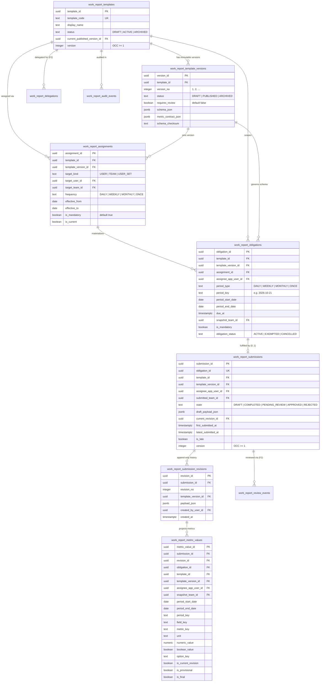

# F0 — Deliverable C: Data Model & Analytics Contract (`F0-data-model-and-analytics-contract.md`)

## 1. Kiến trúc Mô hình Dữ liệu Logic (Logical Entity Relationship)

### 1.1. Sơ đồ Thực thể Logic (RECOMMENDATION)

### 1.2. Tại sao chọn mô hình này? So sánh các phương án kiến trúc (RECOMMENDATION)

| Quyết định thiết kế | Lựa chọn bị loại bỏ | Lý do chọn mô hình đề xuất & Tác động tới F1/F1.5 |
|---|---|---|
| **Tách `work_report_submissions` (current pointer + draft) và `work_report_submission_revisions` (append-only snapshots)** | Lưu mỗi lần nộp lại thành 1 dòng mới trong `work_report_submissions` | Nếu tạo nhiều dòng `submission` cho 1 `obligation`, các câu query F1.5 rất dễ đếm trùng (`COUNT`, `SUM`) khi có bản sửa đổi hoặc bị từ chối nộp lại. Giữ `UNIQUE(obligation_id)` trên `work_report_submissions` bảo đảm **1 nghĩa vụ = tối đa 1 bài nộp hiệu lực**, còn lịch sử mọi lần nộp/sửa được bảo toàn tuyệt đối trong `work_report_submission_revisions`. |
| **Ghi đồng bộ `work_report_metric_values` ngay trong transaction nộp/duyệt báo cáo** | **PA Loại 1:** Đọc toàn bộ `payload_json` về Node.js để cộng. **PA Loại 2:** Dùng `jsonb_each` / `((payload_json->>'key')::numeric)` trực tiếp lúc `SELECT` trên bảng revision. **PA Loại 3:** Xây dựng OLAP cube / Materialized View bất đồng bộ. | - **PA Loại 1** vi phạm hợp đồng hiệu năng & bảo mật của Master Plan §5.3. - **PA Loại 2** không thể đánh B-tree index theo `(template_id, metric_key, period_start_date, snapshot_team_id)`, dễ lỗi runtime cast nếu JSON có null/chuỗi rỗng và khó kiểm soát cross-version compatibility. - **PA Loại 3 (Async Cube)** quá phức tạp, gây trễ dữ liệu (eventual consistency) khiến nhân viên vừa nộp xong Leader mở F1.5 chưa thấy số. - **Mô hình chọn (Synchronous Normalized Projection `work_report_metric_values`):** Khi RPC `work_report_submit` hoặc `work_report_decide_review` chạy, hàm SQL bóc các trường `is_metric = true` hoặc `is_dimension = true` đã qua validate, ghi thẳng vào `work_report_metric_values` trong **cùng một PostgreSQL transaction**. Đảm bảo tính nhất quán tức thì (ACID), có B-tree index chuẩn và truy vấn `SUM/AVG/COUNT` ở F1.5 chạy dưới `10ms`. |
| **Lưu `draft_payload_json` trên `work_report_submissions` thay vì sinh revision cho mỗi lần autosave nháp** | Tạo dòng `work_report_submission_revisions` mỗi lần nhân viên bấm Lưu nháp | Nhân viên có thể lưu nháp 20 lần trước khi nộp. Chỉ khi bấm **Nộp (`SUBMIT`)** mới đóng băng thành `work_report_submission_revisions` (`revision_no = 1, 2...`) và sinh `work_report_metric_values`. Bản nháp chưa nộp tuyệt đối không sinh dòng nào trong `work_report_metric_values`. |

---

## 2. Đặc tả Chi tiết Từng Thực thể Database (RECOMMENDATION)

Mọi bảng mới đều đặt tại schema `public` với tiền tố `work_report_` (đã kiểm tra **0% xung đột tên** với 129 migrations hiện có). Mọi bảng bật `ENABLE ROW LEVEL SECURITY` + `FORCE ROW LEVEL SECURITY` và thu hồi quyền trực tiếp của `PUBLIC, anon, authenticated, service_role` theo chuẩn `S0-T1-C`.

### 2.1. `public.work_report_templates` (Định danh Mẫu Báo cáo)
- **Trách nhiệm:** Lưu danh mục gốc của từng mẫu báo cáo xuyên suốt các phiên bản.
- **Khóa chính / Khóa ngoại:**
  - `template_id uuid primary key default gen_random_uuid()`
  - `current_published_version_id uuid references public.work_report_template_versions(version_id) on delete restrict` (nullable khi đang `DRAFT`)
  - `created_by_user_id uuid not null references public.direct_entry_app_users(app_user_id) on delete restrict`
- **Trường nghiệp vụ quan trọng:**
  - `template_code text not null check (template_code ~ '^[A-Z][A-Z0-9_]{1,63}$')`
  - `display_name text not null check (length(btrim(display_name)) between 1 and 256)`
  - `description text check (description is null or length(description) <= 2000)`
  - `default_frequency text not null check (default_frequency in ('DAILY', 'WEEKLY', 'MONTHLY', 'ONCE'))`
  - `status text not null default 'DRAFT' check (status in ('DRAFT', 'ACTIVE', 'ARCHIVED'))`
  - `version integer not null default 1 check (version >= 1)` (OCC)
- **Unique constraints & Indexes:**
  - `UNIQUE (template_code)`
  - Index `(status, template_code)`
- **Quy tắc bảo toàn lịch sử:** Không bao giờ `DELETE` mẫu đã tạo; ngừng sử dụng chuyển sang `status = 'ARCHIVED'`.

### 2.2. `public.work_report_template_versions` (Phiên bản Schema & Hợp đồng Chỉ tiêu)
- **Trách nhiệm:** Lưu cấu trúc biểu mẫu (`schema_json`), hợp đồng chỉ tiêu (`metric_contract_json`) và cờ `requires_review`.
- **Khóa chính / Khóa ngoại:**
  - `version_id uuid primary key default gen_random_uuid()`
  - `template_id uuid not null references public.work_report_templates(template_id) on delete restrict`
  - `published_by_user_id uuid references public.direct_entry_app_users(app_user_id) on delete restrict`
- **Trường nghiệp vụ quan trọng:**
  - `version_no integer not null check (version_no >= 1)`
  - `status text not null default 'DRAFT' check (status in ('DRAFT', 'PUBLISHED', 'ARCHIVED'))`
  - `requires_review boolean not null default false` (**Mặc định `false` theo quyết định của Owner**)
  - `schema_json jsonb not null` (validate bởi hàm SQL `public.work_report_valid_template_schema(schema_json)`)
  - `metric_contract_json jsonb not null` (validate bởi hàm SQL `public.work_report_valid_metric_contract(schema_json, metric_contract_json)`)
  - `schema_checksum text not null check (schema_checksum ~ '^[a-f0-9]{64}$')`
  - `published_at timestamptz`
- **Unique constraints & Indexes:**
  - `UNIQUE (template_id, version_no)`
  - Partial unique index: chỉ tối đa 1 bản `DRAFT` đang soạn cho mỗi `template_id`: `CREATE UNIQUE INDEX ON public.work_report_template_versions (template_id) WHERE status = 'DRAFT'`.
- **Quy tắc bảo toàn lịch sử:** Trigger DB chặn mọi thao tác `UPDATE` lên `schema_json`, `metric_contract_json`, `requires_review`, `version_no` một khi `old.status in ('PUBLISHED', 'ARCHIVED')` và chặn mọi thao tác `DELETE`.

### 2.3. `public.work_report_assignments` (Quy tắc Giao Báo cáo)
- **Trách nhiệm:** Định nghĩa ai (Cá nhân / Nhóm / Tập người dùng) được giao mẫu báo cáo nào, chu kỳ nào, thời hạn nộp và khoảng hiệu lực.
- **Khóa chính / Khóa ngoại:**
  - `assignment_id uuid primary key default gen_random_uuid()`
  - `template_id uuid not null references public.work_report_templates(template_id) on delete restrict`
  - `template_version_id uuid not null references public.work_report_template_versions(version_id) on delete restrict`
  - `target_user_id uuid references public.direct_entry_app_users(app_user_id) on delete restrict`
  - `target_team_id uuid references public.teams(team_id) on delete restrict`
  - `assigned_by_user_id uuid not null references public.direct_entry_app_users(app_user_id) on delete restrict`
- **Trường nghiệp vụ quan trọng:**
  - `target_kind text not null check (target_kind in ('USER', 'TEAM', 'USER_SET'))`
  - `target_user_ids uuid[]` (chỉ có giá trị khi `target_kind = 'USER_SET'`)
  - `frequency text not null check (frequency in ('DAILY', 'WEEKLY', 'MONTHLY', 'ONCE'))`
  - `is_mandatory boolean not null default true`
  - `timezone text not null default 'Asia/Ho_Chi_Minh' check (timezone = 'Asia/Ho_Chi_Minh')`
  - `due_day_offset integer not null default 0 check (due_day_offset between 0 and 31)` (số ngày cộng thêm từ `period_end_date`)
  - `due_time_local time not null default '23:59:59'`
  - `exclude_sundays boolean not null default false`
  - `effective_from date not null`
  - `effective_to date check (effective_to is null or effective_to >= effective_from)`
  - `state text not null default 'ACTIVE' check (state in ('ACTIVE', 'PAUSED', 'REVOKED'))`
  - `is_current boolean not null default true`
  - `version integer not null default 1 check (version >= 1)`
- **Unique constraints & Indexes:**
  - Partial unique index chống giao trùng 2 assignment đang `is_current = true` cho cùng `(template_id, target_kind, coalesce(target_user_id, ...), coalesce(target_team_id, ...))`.
  - Index `(template_id, is_current)`, `(target_team_id, is_current)`, `(target_user_id, is_current)`.

### 2.4. `public.work_report_obligations` (Kho Nghĩa vụ Phải nộp theo Kỳ)
- **Trách nhiệm:** Nguồn chân lý duy nhất để xác định ai phải nộp báo cáo nào trong kỳ nào và thuộc nhóm nào tại thời điểm kỳ đó phát sinh.
- **Khóa chính / Khóa ngoại:**
  - `obligation_id uuid primary key default gen_random_uuid()`
  - `template_id uuid not null references public.work_report_templates(template_id) on delete restrict`
  - `template_version_id uuid not null references public.work_report_template_versions(version_id) on delete restrict`
  - `assignment_id uuid not null references public.work_report_assignments(assignment_id) on delete restrict`
  - `assignee_app_user_id uuid not null references public.direct_entry_app_users(app_user_id) on delete restrict`
  - `snapshot_team_id uuid references public.teams(team_id) on delete restrict` (team của `assignee_app_user_id` tại thời điểm kỳ báo cáo phát sinh)
  - `status_changed_by_user_id uuid references public.direct_entry_app_users(app_user_id) on delete restrict`
  - `status_reason_id uuid references public.direct_entry_restricted_reasons(reason_id) on delete restrict`
- **Trường nghiệp vụ quan trọng:**
  - `period_type text not null check (period_type in ('DAILY', 'WEEKLY', 'MONTHLY', 'ONCE'))`
  - `period_key text not null` (VD: `'2026-10-21'`, `'2026-W43'`, `'2026-10'`, `'ONCE-2026-10-21'`)
  - `period_start_date date not null`
  - `period_end_date date not null check (period_end_date >= period_start_date)`
  - `due_at timestamptz not null`
  - `snapshot_team_code text`
  - `snapshot_team_display_name text`
  - `is_mandatory boolean not null default true`
  - `obligation_status text not null default 'ACTIVE' check (obligation_status in ('ACTIVE', 'EXEMPTED', 'CANCELLED'))`
  - `version integer not null default 1 check (version >= 1)`
- **Unique constraints & Indexes:**
  - **`UNIQUE (template_id, assignee_app_user_id, period_key)`** — Bảo đảm tuyệt đối 1 nhân sự không bao giờ bị tính 2 nghĩa vụ cho cùng 1 mẫu trong cùng 1 kỳ dù có nhiều assignment chồng lấp.
  - Index `(template_id, period_start_date, period_end_date, obligation_status)`
  - Index `(snapshot_team_id, period_start_date, obligation_status)`
  - Index `(assignee_app_user_id, obligation_status, due_at desc)`

### 2.5. `public.work_report_submissions` (Bài nộp Hiện hành của từng Nghĩa vụ)
- **Trách nhiệm:** Giữ trạng thái vòng đời hiện tại của bài nộp, bản nháp đang soạn (`draft_payload_json`), và con trỏ tới bản nộp chính thức mới nhất (`current_revision_id`).
- **Khóa chính / Khóa ngoại:**
  - `submission_id uuid primary key default gen_random_uuid()`
  - `obligation_id uuid not null unique references public.work_report_obligations(obligation_id) on delete restrict`
  - `template_id uuid not null references public.work_report_templates(template_id) on delete restrict`
  - `template_version_id uuid not null references public.work_report_template_versions(version_id) on delete restrict`
  - `assignee_app_user_id uuid not null references public.direct_entry_app_users(app_user_id) on delete restrict`
  - `submitted_by_user_id uuid references public.direct_entry_app_users(app_user_id) on delete restrict`
  - `submitted_team_id uuid references public.teams(team_id) on delete restrict`
  - `current_revision_id uuid references public.work_report_submission_revisions(revision_id) on delete restrict`
- **Trường nghiệp vụ quan trọng:**
  - `state text not null default 'DRAFT' check (state in ('DRAFT', 'COMPLETED', 'PENDING_REVIEW', 'APPROVED', 'REJECTED'))`
  - `draft_payload_json jsonb` (lưu nháp trước khi nộp hoặc nháp sửa đổi)
  - `first_submitted_at timestamptz`
  - `latest_submitted_at timestamptz`
  - `is_late boolean not null default false` (`first_submitted_at > obligation.due_at`)
  - `has_post_deadline_amendment boolean not null default false`
  - `reviewed_by_user_id uuid references public.direct_entry_app_users(app_user_id) on delete restrict`
  - `reviewed_at timestamptz`
  - `review_reason_id uuid references public.direct_entry_restricted_reasons(reason_id) on delete restrict`
  - `version integer not null default 1 check (version >= 1)` (OCC)
- **Unique constraints & Indexes:**
  - `UNIQUE (obligation_id)`
  - Index `(template_id, state, latest_submitted_at desc)`
  - Index `(submitted_team_id, state)`
  - Index `(assignee_app_user_id, state, updated_at desc)`

### 2.6. `public.work_report_submission_revisions` (Lịch sử Bất biến các lần Nộp)
- **Trách nhiệm:** Lưu trữ bất biến (append-only) toàn bộ nội dung `payload_json` của từng lần nhân viên bấm Nộp / Nộp lại / Bổ sung.
- **Khóa chính / Khóa ngoại:**
  - `revision_id uuid primary key default gen_random_uuid()`
  - `submission_id uuid not null references public.work_report_submissions(submission_id) on delete restrict`
  - `obligation_id uuid not null references public.work_report_obligations(obligation_id) on delete restrict`
  - `template_version_id uuid not null references public.work_report_template_versions(version_id) on delete restrict`
  - `created_by_user_id uuid not null references public.direct_entry_app_users(app_user_id) on delete restrict`
  - `amendment_reason_id uuid references public.direct_entry_restricted_reasons(reason_id) on delete restrict`
- **Trường nghiệp vụ quan trọng:**
  - `revision_no integer not null check (revision_no >= 1)`
  - `payload_json jsonb not null`
  - `payload_checksum text not null check (payload_checksum ~ '^[a-f0-9]{64}$')`
  - `created_at timestamptz not null default now()`
- **Unique constraints & Indexes:**
  - `UNIQUE (submission_id, revision_no)`
- **Quy tắc bảo toàn lịch sử:** Trigger DB chặn mọi lệnh `UPDATE` và `DELETE`.

### 2.7. `public.work_report_metric_values` (Bảng Projection Chuẩn hóa cho Tổng hợp F1.5 & F3)
- **Trách nhiệm:** Lưu các giá trị metric và dimension đã chuẩn hóa từ từng `revision_id` để các RPC tổng hợp F1.5/F3 thực thi bằng SQL có chỉ mục mà không cần đọc/parse `payload_json`.
- **Khóa chính / Khóa ngoại:**
  - `metric_value_id uuid primary key default gen_random_uuid()`
  - `submission_id uuid not null references public.work_report_submissions(submission_id) on delete restrict`
  - `revision_id uuid not null references public.work_report_submission_revisions(revision_id) on delete restrict`
  - `obligation_id uuid not null references public.work_report_obligations(obligation_id) on delete restrict`
  - `template_id uuid not null references public.work_report_templates(template_id) on delete restrict`
  - `template_version_id uuid not null references public.work_report_template_versions(version_id) on delete restrict`
  - `assignee_app_user_id uuid not null references public.direct_entry_app_users(app_user_id) on delete restrict`
  - `snapshot_team_id uuid references public.teams(team_id) on delete restrict`
  - `project_id text references public.direct_entry_projects(project_id) on delete restrict` (nullable — chỉ có khi form có trường `project_id` hợp lệ)
- **Trường nghiệp vụ quan trọng:**
  - `period_type text not null`
  - `period_key text not null`
  - `period_start_date date not null`
  - `period_end_date date not null`
  - `field_key text not null`
  - `metric_key text not null`
  - `compatible_group text not null`
  - `value_type text not null check (value_type in ('INTEGER', 'DECIMAL', 'BOOLEAN', 'SINGLE_SELECT', 'MULTI_SELECT'))`
  - `unit text not null`
  - `numeric_value numeric(18,4)` (dùng cho `INTEGER`, `DECIMAL`; `null` nếu trường không bắt buộc bị bỏ trống)
  - `boolean_value boolean` (dùng cho `BOOLEAN`)
  - `option_key text` (dùng cho `SINGLE_SELECT` / `MULTI_SELECT`)
  - `is_current_revision boolean not null default true`
  - `is_provisional boolean not null default false` (`true` khi `submission.state = 'PENDING_REVIEW'`)
  - `is_final boolean not null default false` (`true` khi `submission.state = 'COMPLETED'` hoặc `'APPROVED'`)
- **Unique constraints & Indexes:**
  - `UNIQUE (revision_id, field_key, coalesce(option_key, ''))`
  - Partial Index phục vụ F1.5/F3 query cực nhanh:
    `CREATE INDEX work_report_metric_values_agg_idx ON public.work_report_metric_values (template_id, metric_key, period_start_date, snapshot_team_id, assignee_app_user_id) WHERE is_current_revision = true AND (is_final = true OR is_provisional = true);`

### 2.8. `public.work_report_review_events` (F2 — Lịch sử Duyệt / Từ chối) & `public.work_report_delegations` (F2 — Ủy quyền) & `public.work_report_audit_events` (F1+ — Nhật ký Bảo mật)
- `work_report_review_events`: Lưu append-only mọi quyết định `APPROVE` / `REJECT` gắn với `submission_id`, `revision_id`, `reviewer_user_id` (`CHECK (reviewer_user_id <> author_user_id)`), `decision`, `reason_id`, `acting_scope_kind`, `acting_team_id`, `delegation_id`.
- `work_report_delegations`: Lưu ủy quyền có thời hạn (`grantor_user_id`, `grantee_user_id`, `capability in ('report_assign', 'report_review')`, `scope_kind`, `scope_team_id`, `template_id`, `valid_from`, `valid_to`, `is_current`, `revoked_at`).
- `work_report_audit_events`: Lưu append-only mọi hành động tạo/publish/archive mẫu, giao việc, miễn nghĩa vụ, nộp, sửa, duyệt, ủy quyền và **xuất file Excel** (`action`, `actor_user_id`, `capability`, `scope_kind`, `scope_team_id`, `template_id`, `obligation_id`, `submission_id`, `outcome`, `reason_id`, `metadata_json`).

---

## 3. Hợp đồng Metric, Dimensions & Quy tắc Tổng hợp (Analytics Contract)

### 3.1. Quy tắc Tổng hợp theo Kiểu Dữ liệu & Chính sách `NULL` / `0` (RECOMMENDATION)

1. **Không tự động coi mọi trường số đều là metric:** Chỉ những trường được người thiết kế mẫu bật `is_metric = true` và khai báo `metric_key`, `unit`, `aggregations` mới được chiếu sang `work_report_metric_values`.
2. **Phân biệt `0`, `NULL` (bỏ trống trường tùy chọn), và Chưa nộp báo cáo (`MISSING`):**
   - **Chưa nộp báo cáo:** Không có dòng `work_report_metric_values` nào.
   - **Đã nộp báo cáo nhưng bỏ trống trường không bắt buộc (`numeric_value IS NULL`):**
     - `SUM`: Bỏ qua `NULL` (nhưng nếu tất cả đều `NULL` thì hiển thị `—` kèm `count_valid = 0`, không hiển thị giả là `0` nếu chưa ai nhập số).
     - `AVG`: Tính trên mẫu số `count_valid = COUNT(numeric_value)` (các bài nộp thực sự có nhập số hợp lệ), **tuyệt đối không tự biến `NULL` thành `0` làm kéo tụt trung bình**.
   - **Đã nộp báo cáo với giá trị `0` hợp lệ (`numeric_value = 0`):**
     - Được tính vào `count_valid` (`+1`), cộng `0` vào `SUM`, và **nằm trong mẫu số của `AVG`**. (Ví dụ: 3 nhân viên gọi `10`, `20`, `0` cuộc gọi ⇒ `SUM = 30`, `count_valid = 3`, `AVG = 10`).
3. **Khi nào dùng `COUNT` vs `COUNT DISTINCT`:**
   - Số lượng nghĩa vụ phải nộp: `COUNT(DISTINCT obligation_id)`.
   - Số lượng bài nộp đóng góp vào chỉ tiêu: `COUNT(DISTINCT submission_id) FILTER (WHERE numeric_value IS NOT NULL)`.
   - Với trường `multi_select` (1 bài nộp có thể chọn nhiều `option_key`): Tổng số bài nộp chọn phương án $X$ là `COUNT(DISTINCT submission_id) FILTER (WHERE option_key = X)`, tỷ lệ % phương án $X$ chia cho tổng số bài nộp hợp lệ `COUNT(DISTINCT submission_id)` (không chia cho tổng số lượt tick để tránh mẫu số sai).
4. **Quy tắc tính Tỷ lệ (Ratio / Percentage Metrics):**
   - Tỷ lệ dẫn xuất (ví dụ: *Tỷ lệ ứng viên quan tâm / cuộc gọi*) được định nghĩa tường minh trong `metric_contract_json` bằng cặp `(numerator_metric_key, denominator_metric_key, scale_factor = 100)`.
   - Công thức bắt buộc ở mọi cấp (Cá nhân, Nhóm, Toàn công ty):
     $$\text{Ratio} = \begin{cases} \text{null} & \text{nếu } \sum \text{denominator} \le 0 \\ \text{ROUND}\left(\frac{\sum \text{numerator}}{\sum \text{denominator}} \times \text{scale\_factor}, 2\right) & \text{nếu } \sum \text{denominator} > 0 \end{cases}$$
   - **Cấm tuyệt đối:** Không bao giờ lấy `AVG(ratio của từng nhân viên)` vì sẽ sai trọng số.
5. **Chống cộng gộp sai đơn vị hoặc khác ý nghĩa giữa các Version:**
   - Mỗi metric có thuộc tính `compatible_group` (mặc định `template_code || ':' || metric_key || ':' || lower(unit)`).
   - RPC tổng hợp chỉ cho phép `GROUP BY metric_key, unit, compatible_group`. Nếu hai version của mẫu đổi `unit` hoặc `compatible_group`, kết quả trả về tách thành 2 dòng chỉ tiêu riêng biệt kèm nhãn version, không bao giờ cộng lẫn.

### 3.2. Các Chiều Phân tích (Dimensions) & Bộ lọc Hỗ trợ (RECOMMENDATION)

| Chiều phân tích (Dimension) | Cột nguồn chuẩn | Ghi chú nghiệp vụ |
|---|---|---|
| **Kỳ công việc (`period`)** | `work_report_obligations.period_start_date`, `period_end_date`, `period_key` | Phản ánh kỳ công việc mà báo cáo mô tả (khác với `submitted_at` là thời điểm bấm nút nộp). |
| **Thời điểm nộp (`submitted_at`)** | `work_report_submissions.first_submitted_at`, `latest_submitted_at` | Dùng để kiểm tra đúng hạn / nộp trễ (`is_late`) và tra cứu nhật ký nộp. |
| **Nhóm tổ chức tại kỳ (`snapshot_team`)** | `work_report_obligations.snapshot_team_id` | **Mặc định trên F1.5:** Giữ cố định số liệu lịch sử của nhóm tại thời điểm kỳ báo cáo diễn ra. |
| **Nhóm tổ chức hiện hành (`current_team`)** | `recruiter_team_memberships.team_id WHERE is_current = true` | Tùy chọn chế độ xem ở F3 (*"Xem theo cơ cấu nhóm hiện tại"*), có nhãn cảnh báo rõ trên UI. |
| **Nhân viên (`assignee`)** | `work_report_obligations.assignee_app_user_id` | Join với `direct_entry_app_users.display_name`. |
| **Mẫu & Phiên bản (`template` / `version`)** | `template_id`, `template_version_id` | Cho phép lọc tất cả version tương thích của 1 mẫu hoặc khóa cứng 1 version. |
| **Trường lựa chọn (`single_select` / `boolean`)** | `work_report_metric_values.option_key` / `boolean_value` | Chỉ bật cho các field có `is_dimension = true`. |
| **Dự án (`project_id`)** | `work_report_metric_values.project_id` | Chỉ kích hoạt khi mẫu báo cáo có field kiểu `project_ref` hợp lệ. |

---

## 4. Phân định Phạm vi F1.5 (Basic Reporting) và F3 (Advanced Analytics)

### 4.1. Hợp đồng API & Chức năng của F1.5 (Bắt buộc có ngay sau F1)

Các API của Work Reports đặt dưới namespace `/api/work-reports/*` (tách biệt hoàn toàn với `/api/reporting/*` của Dashboard Tuyển dụng):

1. `GET /api/work-reports/analytics/overview`
   - **Input (Query params đã qua allowlist):** `template_id` (bắt buộc), `version_id` (tùy chọn), `from` (`YYYY-MM-DD`), `to` (`YYYY-MM-DD`), `team_id` (tùy chọn), `assignee_id` (tùy chọn), ` finality` (`final` mặc định | `provisional_included` ở F2).
   - **Output:**
     - `effective_scope`: `{ kind: 'all' | 'team', label: string }`
     - `compliance`: `{ due_count, completed_count, on_time_count, late_submitted_count, pending_due_count, overdue_missing_count, exempted_count, pending_review_count, completion_rate }`
     - `metrics`: mảng `{ metric_key, label, unit, compatible_group, sum_value, avg_value, min_value, max_value, count_valid, missing_value_count }`
2. `GET /api/work-reports/analytics/breakdown`
   - **Input:** Cùng bộ lọc với `overview` + `group_by` (`team` | `assignee` | `period`) + `page`, `page_size`.
   - **Output:** Bảng tổng hợp theo từng Nhân viên / Nhóm / Kỳ (gồm cả số nghĩa vụ phải nộp, đã nộp, quá hạn VÀ giá trị `SUM`/`AVG` của các chỉ tiêu chính trên từng dòng).
3. `GET /api/work-reports/analytics/contributions` (Drill-down từ KPI / Breakdown xuống bài nộp nguồn)
   - **Input:** Cùng bộ lọc + `metric_key` (tùy chọn) + `target_team_id` / `target_assignee_id` / `target_period_key` + `cursor`, `limit`.
   - **Output:** Danh sách các dòng nghĩa vụ/bài nộp đóng góp trực tiếp vào con số KPI đó (kèm `obligation_id`, `submission_id`, `revision_no`, `assignee_display_name`, `team_display_name`, `period_key`, `state`, `submitted_at`, `is_late`, `metric_contribution_value`), đảm bảo **tổng các dòng contribution khớp 100% với KPI trên thẻ tổng hợp**.
4. `GET /api/work-reports/submissions/[submissionId]`
   - **Output:** Snapshot chi tiết của bài nộp (chỉ trả về khi bài nộp nằm trong `effective_scope` của người gọi).
5. `POST /api/work-reports/analytics/export` (Khuyến nghị đưa bản cơ bản vào cuối F1.5 — xem `OD-06`)
   - **Output:** File `.xlsx` gồm Sheet 1 (*Tổng hợp Tuân thủ & Chỉ tiêu theo Nhóm/Nhân viên*) và Sheet 2 (*Chi tiết từng Nghĩa vụ & Bài nộp trong phạm vi quyền*), ghi nhận vào `work_report_audit_events`.

### 4.2. Phạm vi mở rộng ở F3 (Advanced Analytics)

- So sánh kỳ này với kỳ trước (`Period-over-Period`: `delta_abs`, `delta_pct` có xử lý mẫu số `= 0`).
- Biểu đồ xu hướng chuỗi thời gian (`TrendChart` theo Ngày/Tuần/Tháng/Quý/Năm) và biểu đồ phân bổ theo trường `single_select`/`multi_select`.
- Chỉ số dẫn xuất (Derived Ratio Metrics `SUM(A)/SUM(B)` cấu hình declarative qua whitelist).
- Cảnh báo chất lượng dữ liệu (Data Quality Alerts: kỳ thiếu bài nộp, biến động bất thường, mẫu có nhiều version không tương thích đơn vị).
- Chế độ chuyển đổi xem theo *Cơ cấu tổ chức tại kỳ (`snapshot_team_id`)* vs *Cơ cấu tổ chức hiện tại (`current_team_id`)*.
