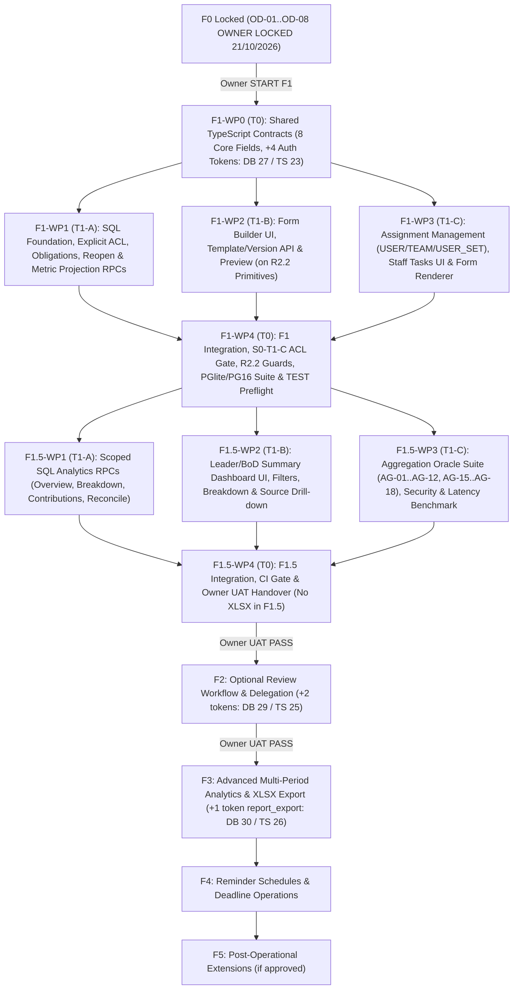

# F0 — Deliverable F: Execution Roadmap (`F0-execution-roadmap.md`)

> [!IMPORTANT]
> - **Initial Survey Baseline (`origin/main`):** `8bf16afe9360e5eebe0dd9183c8ef9d85fc39b0c` (`8bf16afe`)
> - **Delta Review & Effective Baseline (`origin/main` after PR #97 R2.2 Visual Completion):** `bd67c4b88106d6147b1fd043fadc4326366a0e69` (`bd67c4b` — 129 migrations; 0 thay đổi lên DB/auth/navigation contract; đã bổ sung R2.2 UI primitives và 3 bài test cổng R2.2).
> - **Owner Decisions Locked (`21/10/2026` — `OWNER LOCKED`):** Toàn bộ 8 quyết định `OD-01` → `OD-08` đã được Product Owner chính thức phê duyệt khóa ngày `21/10/2026` tại [`./F0-product-contracts-and-open-decisions.md`](./F0-product-contracts-and-open-decisions.md#L212-L225).
> - **Cổng kích hoạt F1:** Dù hợp đồng F0 đã khóa, không một Work Package nào của F1/F1.5 được tự ý bắt đầu trước khi có review cuối của T0 và lệnh `START F1` riêng từ Product Owner.

---

## 1. Sơ đồ Phụ thuộc & Đường Găng (Critical Path — `OWNER LOCKED`)

---

## 2. Phân rã Work Packages & Ma trận Sở hữu File Độc quyền (`F1` & `F1.5` — `OWNER LOCKED`)

Để 3 luồng agent (`T1-A`, `T1-B`, `T1-C`) có thể phát triển song song mà không xảy ra merge conflict hay tự diễn giải nghiệp vụ khác nhau, **T0 khóa trước file contract dùng chung (`F1-WP0`)**, sau đó phân chia quyền sở hữu file độc quyền như sau:

### 2.1. Giai đoạn F1 — Form Builder, Giao Báo cáo, Nộp Báo cáo & Lưu trữ Chuẩn hóa

| Work Package | Phụ trách | Cỡ (Effort) | Phụ thuộc (Prerequisites) | Phạm vi công việc & File sở hữu độc quyền (Exclusive Ownership) |
|---|---|---|---|---|
| **F1-WP0: Shared Contracts & Pure Validators** | **T0** | **S** | Lệnh `START F1` từ Product Owner | - Khóa các kiểu dữ liệu dùng chung tại `src/lib/work-reports/contracts.ts`, `src/lib/work-reports/schema-validator.ts`, `src/lib/work-reports/metric-contract.ts`, `src/lib/work-reports/period-utils.ts` + unit tests cho đúng **8 kiểu trường core** (`OD-08 = PA3`: không có trường hay bộ lọc dự án) và Mẫu nghiệp vụ #1 (*Báo cáo công việc tuyển dụng ngày*, `OD-01`). - Mở rộng `CAPABILITIES` (`direct-entry-auth/1.5`) tại [`../../src/lib/auth/direct-entry-v2.ts`](../../src/lib/auth/direct-entry-v2.ts#L7-L30) thêm đúng **4 token** (`report_form_manage`, `report_assign`, `report_view`, `report_analytics_view` ⇒ **TypeScript `CAPABILITIES` = `23`**) cùng predicate điều hướng tại [`../../src/lib/navigation/registry.ts`](../../src/lib/navigation/registry.ts#L104-L177), [`../../src/lib/navigation/registry-capability.ts`](../../src/lib/navigation/registry-capability.ts#L149-L161), [`../../src/lib/auth/direct-entry-page-access.ts`](../../src/lib/auth/direct-entry-page-access.ts#L96-L106). |
| **F1-WP1: Database Foundation, Obligations & Synchronous Metric Projection** | **T1-A** | **L** | `F1-WP0` | - Tạo migration forward-only `supabase/migrations/YYYYMMDDHHMMSS_work_reports_f1_foundation.sql` gồm các bảng: `work_report_templates`, `work_report_template_versions`, `work_report_assignments`, `work_report_assignment_targets` (chuẩn hóa `USER_SET`), `work_report_obligations`, `work_report_submissions`, `work_report_submission_revisions`, `work_report_metric_values` (có cột `is_eligible boolean not null`, không có cột dự án theo `OD-08 = PA3`), `work_report_audit_events`. - Thực thi `REVOKE ALL` / `GRANT` tường minh chỉ trên các bảng, sequence và function `public.work_report_*` mới tạo. - Cài đặt các RPC `SECURITY DEFINER` cho Template CRUD/Publish, Assignment CRUD (chặn toàn bộ transaction nếu `USER_SET` có người ngoài scope của người giao theo `OD-03 = PA1`), miễn nghĩa vụ (`EXEMPT` bắt buộc reason + audit theo `OD-03 = PA1`), mở lại nghĩa vụ sau hạn (`REOPEN` bởi người có `report_assign` trong scope, bắt buộc reason + audit theo `OD-02 = PA1`), `work_report_ensure_obligations_for_window`, `work_report_save_draft`, `work_report_submit` (cho phép tạo revision mới khi `<= due_at` hoặc đã được mở lại; tính `is_late` theo `first_submitted_at > due_at` và gán `has_post_deadline_amendment = true` theo `OD-05 = PA1`; ghi đồng bộ `work_report_metric_values` ngay trong transaction nộp). - Cập nhật `direct_entry_apply_team_leader_mutation` theo `OD-04 = PA1`: tự động cấp/thu hồi `report_view`, `report_analytics_view`, `report_assign` trong `scope = team` khi bổ nhiệm/bãi nhiệm Team Leader. - Cập nhật [`../../scripts/s0-t1-c-rpc-acl.test.mjs`](../../scripts/s0-t1-c-rpc-acl.test.mjs) và 6 file test P3.1 ([`../../scripts/p3-1-w01a-capability-contract.test.mjs`](../../scripts/p3-1-w01a-capability-contract.test.mjs#L135-L143)..`w01d`) với số lượng token cố định **DB CHECK = `27` / TypeScript = `23`** (`OD-07 = PA1`). - Viết `scripts/work-reports-f1-db.test.mjs`. |
| **F1-WP2: Form Builder, Version Management & Preview UI/API** | **T1-B** | **M** | `F1-WP0` (chạy song song với `F1-WP1` & `F1-WP3` qua repository interface) | - Repository & API quản lý mẫu: `src/lib/work-reports/template-repository.ts`, `src/lib/work-reports/template-api.ts`, `src/app/api/work-reports/templates/**`. - Giao diện Quản lý Mẫu & Form Builder: `src/app/work-reports/templates/**`, `src/components/work-reports/form-builder/**` (hỗ trợ 8 kiểu trường core, tái sử dụng [`PageShell`](../../src/components/ui/page-shell.tsx#L5-L74), [`Button`](../../src/components/ui/button.tsx#L42-L81), [`StatusBadge`](../../src/components/ui/badge.tsx#L31-L65), [`DataTableContainer`](../../src/components/ui/data-table.tsx#L11-L80), [`FormDialog`](../../src/components/ui/form-dialog.tsx#L14-L88), [`FloatingToast`](../../src/components/ui/toast.tsx#L28-L97), [`StatusBanner`](../../src/components/ui/status-banner.tsx#L14-L41)). - Tests: `src/lib/work-reports/template-api.test.mjs`, `src/components/work-reports/form-builder/form-builder.test.mjs`. |
| **F1-WP3: Assignment Management, Staff Obligations Inbox & Dynamic Form Renderer** | **T1-C** | **L** | `F1-WP0` (chạy song song với `F1-WP1` & `F1-WP2`) | - Repository & API giao việc / nộp báo cáo: `src/lib/work-reports/assignment-repository.ts`, `src/lib/work-reports/assignment-api.ts`, `src/lib/work-reports/submission-repository.ts`, `src/lib/work-reports/submission-api.ts`, `src/app/api/work-reports/assignments/**`, `src/app/api/work-reports/obligations/**`, `src/app/api/work-reports/submissions/**`. - Giao diện Giao báo cáo (`/work-reports/assignments` hỗ trợ `USER`, `TEAM`, `USER_SET`, miễn nghĩa vụ `EXEMPT` và mở lại sau hạn `REOPEN`), Cần báo cáo & Lịch sử của tôi (`/work-reports`, `/work-reports/my-reports`), và `WorkReportFormRenderer` (`src/components/work-reports/renderer/**` tái sử dụng [`PageShell`](../../src/components/ui/page-shell.tsx#L5-L74), [`FilterToolbar`](../../src/components/ui/filter-toolbar.tsx#L5-L41), [`DataTableContainer`](../../src/components/ui/data-table.tsx#L11-L80), [`RowOverflowMenu`](../../src/components/ui/mobile-action-sheet.tsx#L23-L76), [`OffsetPager`](../../src/components/ui/offset-pager.tsx#L7-L64), [`FloatingToast`](../../src/components/ui/toast.tsx#L28-L97), [`StatusBanner`](../../src/components/ui/status-banner.tsx#L14-L41)). - Tests: `src/lib/work-reports/assignment-api.test.mjs`, `src/lib/work-reports/submission-api.test.mjs`, `src/components/work-reports/renderer/form-renderer.test.mjs`. |
| **F1-WP4: F1 Integration, CI Gate & Owner UAT Checklist** | **T0** | **M** | `F1-WP1`, `F1-WP2`, `F1-WP3` | - Tích hợp 3 nhánh `T1-A/B/C`, đăng ký test vào [`../../package.json`](../../package.json#L10-L143) & [`../../scripts/ci-test-manifest.mjs`](../../scripts/ci-test-manifest.mjs). - Chạy toàn bộ cổng kiểm tra: `typecheck`, `lint`, `build`, `s0-t1-c-rpc-acl`, `ci-test-manifest`, và 3 bài test cổng R2.2 ([`../../scripts/r2-2-grid-no-touch-guard.test.mjs`](../../scripts/r2-2-grid-no-touch-guard.test.mjs#L1-L261), [`../../scripts/r2-2-theme-mobile-contract.test.mjs`](../../scripts/r2-2-theme-mobile-contract.test.mjs#L1-L265), [`../../scripts/r2-2-surface-coverage.test.mjs`](../../scripts/r2-2-surface-coverage.test.mjs#L1-L82)). - Chuẩn bị checklist UAT F1 cho Product Owner (sử dụng Mẫu #1 theo `OD-01`). |

---

### 2.2. Giai đoạn F1.5 — Basic Reporting, Scoped SQL Aggregation & Source Drill-down (Làm ngay sau F1; Không có XLSX theo `OD-06 = PA2` OWNER LOCKED)

| Work Package | Phụ trách | Cỡ (Effort) | Phụ thuộc (Prerequisites) | Phạm vi công việc & File sở hữu độc quyền (Exclusive Ownership) |
|---|---|---|---|---|
| **F1.5-WP1: Scoped SQL Analytics & Reconciliation Engine** | **T1-A** | **M** | `F1-WP4` | - Tạo migration forward-only `supabase/migrations/YYYYMMDDHHMMSS_work_reports_f1_5_analytics.sql` gồm các RPC: `work_report_analytics_overview`, `work_report_analytics_breakdown`, `work_report_analytics_contributions` (drill-down), `work_report_reconcile_metric_projection`. - Thực thi kiểm tra quyền `report_analytics_view`, `report_view` và lọc cứng theo `effective_scope` (`all` vs `team`) trên tập `WHERE is_eligible = true AND is_final = true`. - Mở rộng [`../../scripts/s0-t1-c-rpc-acl.test.mjs`](../../scripts/s0-t1-c-rpc-acl.test.mjs) với ACL tường minh cho các hàm mới. |
| **F1.5-WP2: Summary Dashboard UI, Breakdown & Source Drill-down** | **T1-B** | **M** | `F1-WP4` (chạy song song với `F1.5-WP1`) | - API & Repository tổng hợp: `src/lib/work-reports/analytics-contract.ts`, `src/lib/work-reports/analytics-repository.ts`, `src/lib/work-reports/analytics-api.ts`, `src/app/api/work-reports/analytics/{overview,breakdown,contributions}/**`. - Màn hình **Tổng hợp báo cáo** (`/work-reports/analytics`, `src/components/work-reports/analytics/**` tái sử dụng [`PageShell`](../../src/components/ui/page-shell.tsx#L5-L74), [`FilterToolbar`](../../src/components/ui/filter-toolbar.tsx#L5-L41), [`KpiCard`](../../src/components/dashboard/kpi-card.tsx), [`ReportTableContainer`](../../src/components/ui/report-table.tsx#L9-L48), [`OffsetPager`](../../src/components/ui/offset-pager.tsx#L7-L64), [`CursorLoadMore`](../../src/components/ui/cursor-load-more.tsx#L3-L34), [`FormDialog`](../../src/components/ui/form-dialog.tsx#L14-L88), [`FloatingToast`](../../src/components/ui/toast.tsx#L28-L97), [`StatusBanner`](../../src/components/ui/status-banner.tsx#L14-L41)): Bộ lọc (`nuqs` không có filter dự án theo `OD-08 = PA3`), thẻ Compliance KPI, thẻ Metric Summary (`SUM`, `AVG`, `COUNT_VALID`), bảng Breakdown theo Nhóm/Nhân viên/Kỳ, và Drawer/Modal Drill-down xem danh sách bài nộp đóng góp + mở xem bài nộp nguồn (không có XLSX ở F1.5 theo `OD-06 = PA2`). - Tests: `src/lib/work-reports/analytics-api.test.mjs`, `src/components/work-reports/analytics/analytics-view.test.mjs`. |
| **F1.5-WP3: Aggregation Oracle, Security Regression & Latency Verification** | **T1-C** | **M** | `F1.5-WP1` | - Xây dựng bộ fixture độc lập `scripts/lib/work-reports-oracle-fixture.mjs` (Mẫu nghiệp vụ #1 + technical fixtures cho các field type/chu kỳ khác theo `OD-01`) và hai suite kiểm thử DB bắt buộc:   1. `scripts/work-reports-aggregation-oracle-db.test.mjs` (kiểm chứng các kịch bản `AG-01` → `AG-12`, `AG-15` → `AG-18`).   2. `scripts/work-reports-authorization-matrix-db.test.mjs` (kiểm chứng `SEC-WR-01` → `SEC-WR-03`, `SEC-WR-05` → `SEC-WR-08`, `SEC-WR-11`, `SEC-WR-12`). - Đo kiểm chứng thực nghiệm các `PERFORMANCE TARGET` (`< 25ms` SQL query, `p95 < 3s` API trên fixture 18.250 nghĩa vụ/năm). |
| **F1.5-WP4: F1.5 Release Gate & Owner UAT Sign-off** | **T0** | **S** | `F1.5-WP1`, `F1.5-WP2`, `F1.5-WP3` | - Tích hợp, chạy full CI (bao gồm `test:r2-2`) và ghi nhận kết quả đo benchmark thực tế từ `F1.5-WP3`. - Bàn giao checklist UAT F1.5 cho Product Owner. **Dừng chờ Owner xác nhận UAT PASS trên TEST trước khi mở F2.** |

---

### 2.3. Các Giai đoạn Tiếp theo (`F2`, `F3`, `F4`, `F5` — `OWNER LOCKED`)

| Giai đoạn | Work Packages chính | Điều kiện tiên quyết |
|---|---|---|
| **F2: Optional Review Workflow & Delegation** | - **F2-WP1 (T1-A):** Migration bổ sung **2 capability token** (`report_review`, `report_delegate` ⇒ nâng **DB CHECK lên `29`**, nâng **TypeScript `CAPABILITIES` lên `25`** theo `OD-07 = PA1`), cập nhật `direct_entry_apply_team_leader_mutation` để tự động cấp/thu hồi thêm `report_review @ team` cho Team Leader (`OD-04 = PA1`), cài đặt RPC duyệt/từ chối (`work_report_decide_review` với chặn tự duyệt `reviewer <> author`), bảng & RPC ủy quyền `work_report_delegations`, chuyển trạng thái `is_provisional`, `is_final`, `is_eligible`. - **F2-WP2 (T1-B):** Màn hình **Duyệt báo cáo** (`/work-reports/reviews`), hộp thoại phê duyệt/từ chối kèm lý do, giao diện quản lý Ủy quyền có thời hạn. - **F2-WP3 (T1-C):** Cập nhật hiển thị nhãn `Tạm tính (Chờ duyệt)` vs `Chốt (Đã duyệt)` trên Dashboard và bộ test `AG-13`, `SEC-WR-09`, `SEC-WR-10`. | F1.5 đã được Product Owner nghiệm thu PASS. |
| **F3: Advanced Analytics, Cross-Period Comparison & Excel Export (`OD-06 = PA2` OWNER LOCKED)** | - **F3-WP1 (T1-A):** RPC so sánh liên kỳ (`Period-over-Period`), chỉ số tỷ lệ dẫn xuất (`SUM(num)/SUM(den)`), cảnh báo chất lượng dữ liệu, tùy chọn xem theo cơ cấu nhóm hiện tại vs tại kỳ. - **F3-WP2 (T1-B):** Biểu đồ xu hướng (`TrendChart`), biểu đồ phân bổ theo trường danh mục (`single_select`/`multi_select`), bảng so sánh các Team. - **F3-WP3 (T1-C):** Bổ sung capability `report_export` (**+1 token ⇒ DB CHECK = `30`, TypeScript `CAPABILITIES` = `26`** theo `OD-07 = PA1`), cập nhật `direct_entry_apply_team_leader_mutation` để tự động cấp/thu hồi `report_export @ team` cho Team Leader (`OD-04 = PA1`), cài đặt RPC `work_report_export_data`, route `POST /api/work-reports/analytics/export`, `buildWorkReportExportXlsx` và bộ test `AG-14`, `SEC-WR-04`. | F2 đã được Product Owner nghiệm thu PASS. |
| **F4: Reminders & Deadline Operations** | - Cấu hình lịch nhắc trước hạn / sắp đến hạn / quá hạn theo `work_report_obligations` (`idempotent reminder log` chống gửi trùng), danh sách nhân sự chưa nộp cho Team Leader hỗ trợ. | F3 hoàn tất. |
| **F5: Post-Operational Extensions** | - Chỉ triển khai từng hạng mục khi có nhu cầu thực tế từ vận hành và được Product Owner duyệt riêng bằng migration forward-only (repeater rows, file đính kèm R2, công thức nâng cao, hoặc liên kết danh mục dự án nếu Owner yêu cầu về sau). | Theo quyết định thực tế của Owner. |

---

## 3. Các Rủi ro Thiết kế lại (Redesign Risks) & Cách F0 Đã Khóa Phòng ngừa

| Rủi ro có thể gây phải đập đi xây lại ở F1.5 / F2 / F3 | Nguyên nhân nếu thiết kế sai ở F1 | Cách Hợp đồng F0 đã khóa để triệt tiêu rủi ro |
|---|---|---|
| **Rủi ro 1: F1 chỉ lưu cục `payload_json`, sang F1.5 không thể tính tổng hay lọc nhanh** | Không thiết kế `metric_contract_json` và bảng `work_report_metric_values` ngay từ F1. | F0 bắt buộc `work_report_template_versions` có `metric_contract_json` và `work_report_submit` ở **F1-WP1** phải ghi đồng bộ `work_report_metric_values` (kèm `is_eligible`) ngay trong cùng transaction. Sang F1.5 chỉ việc viết câu `SELECT SUM/AVG` trên bảng đã có sẵn dữ liệu. |
| **Rủi ro 2: Tỷ lệ hoàn thành bị tính sai (luôn = 100%) hoặc biến động lịch sử khi nhân sự đổi Team** | Tính mẫu số bằng `COUNT(submissions)` hoặc `JOIN` trực tiếp vào bảng `recruiter_team_memberships` hiện tại. | F0 khóa bảng `work_report_obligations` có `UNIQUE(template_id, assignee_app_user_id, period_key)` và lưu cứng `snapshot_team_id` tại thời điểm kỳ báo cáo phát sinh. |
| **Rủi ro 3: Sửa báo cáo hoặc nộp lại sau khi bị từ chối làm nhân đôi số liệu KPI** | Lưu mỗi lần nộp lại thành một dòng `submission` mới và cộng tất cả các dòng. | F0 khóa `UNIQUE(obligation_id)` trên `work_report_submissions`, tách lịch sử vào `work_report_submission_revisions`, và dùng bộ cờ `is_current_revision` + `is_eligible = (is_current_revision AND (is_final OR is_provisional))` trên `work_report_metric_values`. |
| **Rủi ro 4: Đổi tên nhãn hoặc thêm trường ở Version 2 làm hỏng thống kê của Version 1** | Dùng `label` làm key lưu trữ hoặc cho phép sửa đè `schema_json` của version đã publish. | F0 khóa `field_key` và `metric_key` bất biến; `template_version` đã publish bị chặn sửa bằng trigger DB; kiểm tra tương thích đơn vị (`compatible_group`) trước khi cho phép gộp số liệu liên version. |
| **Rủi ro 5: Mở rộng Capability làm gãy 6 bài test CI hiện hữu của P3.1 hoặc hở quyền PostgREST** | Không kiểm tra các test hiện có trong `scripts/` trước khi sửa constraint `direct_entry_capability_grants_capability_check`, hoặc dùng lệnh `REVOKE` quét toàn schema. | F0 đã chỉ rõ chính xác 6 file test P3.1 (`p3-1-w01a..w01d`), lộ trình số lượng token cố định (`27/23` ở F1/F1.5 → `29/25` ở F2 → `30/26` ở F3), và quy tắc `REVOKE`/`GRANT` tường minh chỉ trên các bảng/sequence/hàm `work_report_*` kèm kiểm tra qua [`../../scripts/s0-t1-c-rpc-acl.test.mjs`](../../scripts/s0-t1-c-rpc-acl.test.mjs). |
