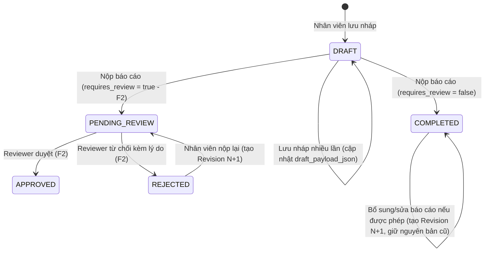

# F0 — Deliverable B: Product Contracts & Open Decisions (`F0-product-contracts-and-open-decisions.md`)

> [!IMPORTANT]
> Tài liệu này phân biệt rõ 4 trạng thái thông tin:
> - **FACT:** Đã xác minh trong codebase/database hoặc đã được Product Owner chốt trong Master Plan §0.1.
> - **RECOMMENDATION:** Phương án kiến trúc/nghiệp vụ do T0 đề xuất để khóa hợp đồng F1/F1.5.
> - **OPEN DECISION (`OD-*`):** Điểm cần Product Owner xác nhận trước khi chạy migration đầu tiên của F1.
> - **OUT OF SCOPE:** Thuộc các phase sau hoặc ngoài phạm vi F0.

---

## 1. Hợp đồng Form Builder (`schema_json` & Versioning)

### 1.1. Tập kiểu trường tối thiểu cho MVP F1 (RECOMMENDATION)

Mỗi phiên bản mẫu báo cáo (`work_report_template_versions`) chứa một mảng `sections` và danh sách `fields`. Để đảm bảo nhập liệu nhanh, validate chặt ở cả client/server/DB và tổng hợp chính xác ở F1.5, tập `field_type` trong F1 gồm **7 kiểu dữ liệu**:

| `field_type` | Kiểu giá trị JSON | Cho phép làm Metric (`aggregatable`)? | Cho phép làm Dimension / Filter? | Quy tắc Validation cấu hình được |
|---|---|---|---|---|
| `text` | `string` (1 dòng) | Không (chỉ `COUNT_VALID` nếu bắt buộc) | Không | `required`, `min_length` (0..500), `max_length` (1..500), `pattern_preset` (`none` \| `code` \| `phone` \| `email`) |
| `textarea` | `string` (nhiều dòng) | Không | Không | `required`, `min_length` (0..4000), `max_length` (1..4000) |
| `integer` | `number` (số nguyên an toàn) | **Có** (`SUM`, `AVG`, `MIN`, `MAX`, `COUNT_VALID`) | Không | `required`, `min_value`, `max_value`, `allow_zero` (mặc định `true`) |
| `decimal` | `number` (tối đa 4 chữ số thập phân, lưu DB `numeric(18,4)`) | **Có** (`SUM`, `AVG`, `MIN`, `MAX`, `COUNT_VALID`) | Không | `required`, `min_value`, `max_value`, `decimal_places` (`1..4`), `allow_zero` |
| `date` | `string` (`YYYY-MM-DD`) | Không | Có (ở F3 nếu cần lọc theo ngày sự kiện) | `required`, `min_date_rule` (`any` \| `within_period` \| `not_future`) |
| `boolean` | `boolean` (`true` / `false`) | **Có** (`TRUE_COUNT`, `TRUE_RATE`) | **Có** | `required`, `default_value` (`true` \| `false` \| `null`) |
| `single_select` | `string` (`option_key`) | **Có** (breakdown đếm theo từng `option_key`) | **Có** (F1.5/F3 filter & group-by) | `required`, `options` (mảng `{ option_key, label, active, sort_order }`, tối đa 50 lựa chọn) |
| `multi_select` | `string[]` (mảng `option_key` duy nhất) | **Có** (đếm số báo cáo chứa `option_key`) | **Có** (F3 filter `contains`) | `required`, `min_selected`, `max_selected`, `options` (tối đa 50 lựa chọn) |

**Các loại trường đề xuất ĐỂ SAU (OUT OF SCOPE cho F1–F3, chuyển sang F5):**
- Upload file/ảnh đính kèm, chữ ký tay.
- Bảng con lặp (nested repeater / sub-table).
- Biểu thức tính toán tự do do người dùng tự gõ công thức JS/SQL.
- Conditional logic (ẩn/hiện nhiều tầng phức tạp).

### 1.2. Cấu trúc Metadata của từng Field (RECOMMENDATION)

Không bao giờ dùng `label` hiển thị làm định danh lưu trữ. Mỗi field trong `schema_json` có hợp đồng:

```json
{
  "field_key": "workers_started",
  "section_key": "daily_kpi",
  "sort_order": 30,
  "label": "NLĐ đi làm",
  "description": "Số người lao động thực tế nhận việc trong ngày báo cáo",
  "field_type": "integer",
  "required": true,
  "default_value": 0,
  "validation": {
    "min_value": 0,
    "max_value": 10000
  },
  "options": null,
  "is_metric": true,
  "metric_spec": {
    "metric_key": "workers_started",
    "unit": "người",
    "aggregations": ["SUM", "AVG", "COUNT_VALID"],
    "null_policy": "EXCLUDE_FROM_AVG",
    "zero_policy": "INCLUDE_AS_ZERO",
    "compatible_group": "recruitment_daily_workers_started_v1"
  },
  "is_dimension": false
}
```

- **Quy tắc bất biến của `field_key` và `metric_key`:**
  - Định dạng chuẩn: `^[a-z][a-z0-9_]{1,63}$` (snake_case).
  - `field_key` là khóa duy nhất trong một `template_version` và là key trong `submission_payload_json`.
  - `metric_key` định danh ý nghĩa thống kê xuyên suốt các version của cùng một mẫu báo cáo.

### 1.3. Vòng đời Mẫu & Quy tắc Versioning (FACT + RECOMMENDATION)

- **Vòng đời Template (`work_report_templates.status`):**
  - `DRAFT`: Mới khởi tạo, chưa có version nào được publish.
  - `ACTIVE`: Đã có ít nhất 1 `template_version` ở trạng thái `PUBLISHED`.
  - `ARCHIVED`: Ngừng giao mới; mọi lịch sử nghĩa vụ, bài nộp và số liệu thống kê F1.5/F3 vẫn tra cứu bình thường.
- **Vòng đời Phiên bản Mẫu (`work_report_template_versions.status`):**
  - `DRAFT` → `PUBLISHED` → `SUPERSEDED` / `ARCHIVED`.
  - **Một khi đã chuyển sang `PUBLISHED`, `schema_json`, `metric_contract_json` và `requires_review` của `template_version` đó là BẤT BIẾN (immutable — chặn sửa bằng trigger DB).**
- **Điều gì xảy ra khi sửa mẫu đã có submission?**
  1. Admin bấm **"Tạo phiên bản mới (Clone to Draft v{N+1})"** từ version `v{N}` đang `PUBLISHED`.
  2. Các nghĩa vụ (`work_report_obligations`) và bài nộp (`work_report_submissions`) đã phát sinh ở kỳ cũ vẫn giữ nguyên khóa ngoại `template_version_id = v{N}`.
  3. Khi Admin `PUBLISH` phiên bản `v{N+1}`:
     - Các kỳ báo cáo **chưa mở / phát sinh từ ngày hiệu lực của version mới** sẽ dùng `v{N+1}`.
     - Các kỳ đang mở hoặc đã đóng của `v{N}` vẫn nhập/đọc/validate theo `v{N}`.
- **Ảnh hưởng của việc thêm, sửa, xóa, đổi kiểu field giữa `v{N}` và `v{N+1}`:**

| Thay đổi ở `v{N+1}` | Quy tắc kiểm tra khi Publish `v{N+1}` | Tác động tới báo cáo cũ & tổng hợp liên kỳ |
|---|---|---|
| Sửa `label`, `description`, thứ tự hiển thị của field giữ nguyên `field_key` & `metric_key` | Cho phép giữ nguyên `metric_key` nếu `field_type` và `unit` không đổi | Cộng gộp (`SUM`/`AVG`) xuyên suốt `v{N}` và `v{N+1}` liền mạch |
| Thêm field mới (`new_field_key`) | Hợp lệ | Báo cáo cũ ở `v{N}` không có field này (không tính vào `COUNT_VALID` hay mẫu số `AVG` của `new_field_key`) |
| Ẩn/bỏ một field cũ ở `v{N+1}` | Hợp lệ | Dữ liệu cũ ở `v{N}` vẫn hiển thị nguyên vẹn khi xem snapshot `v{N}` và vẫn được tổng hợp cho các kỳ thuộc `v{N}` |
| Đổi `field_type` (VD: `text` → `integer`) hoặc đổi `unit` (VD: `người` → `giờ`) hoặc đổi ý nghĩa nghiệp vụ | **DB/Server chặn dùng lại cùng `metric_key` hoặc cùng `field_key` khác kiểu dữ liệu**; bắt buộc đặt `field_key`/`metric_key` mới | Tránh tuyệt đối việc cộng nhầm hai đại lượng khác đơn vị/ý nghĩa giữa hai version |

---

## 2. Hợp đồng Vòng đời Báo cáo (Submission Lifecycle) & Duyệt tùy chọn

### 2.1. Tách biệt Trạng thái Nghĩa vụ (Obligation State) và Trạng thái Bài nộp (Submission State) (FACT + RECOMMENDATION)

Một lỗi thiết kế phổ biến là gộp trạng thái *"Chưa nộp / Quá hạn"* vào bảng `submissions`. Nếu nhân viên chưa bao giờ bấm tạo báo cáo thì chưa có dòng `submission` nào, hoặc chỉ mới có bản `DRAFT`. Do đó:

1. **Bảng `work_report_obligations` quản lý nghĩa vụ phải nộp** (1 dòng cho mỗi `assignee_app_user_id × template_id × period_key`):
   - `obligation_status` lưu trữ trạng thái quản trị:
     - `ACTIVE`: Nghĩa vụ có hiệu lực.
     - `EXEMPTED`: Được miễn nghĩa vụ trong kỳ này (có `reason_id` + người miễn + audit; **loại khỏi mẫu số phải nộp**).
     - `CANCELLED`: Đã hủy do thu hồi assignment trước khi kỳ kết thúc hoặc nhân sự nghỉ việc trước kỳ (có audit; **loại khỏi mẫu số phải nộp**).
   - `fulfillment_state` (trạng thái hoàn thành nghĩa vụ, tính toán nhất quán từ `obligation` + `current_submission` + thời gian hiện tại `as_of` theo múi giờ `Asia/Ho_Chi_Minh`):
     - `UPCOMING`: Chưa nộp (`current_submission` chưa nộp) VÀ `as_of < period_start`.
     - `DUE`: Chưa nộp VÀ `period_start <= as_of <= due_at`.
     - `OVERDUE_MISSING`: Chưa nộp VÀ `as_of > due_at`.
     - `SUBMITTED_PENDING_REVIEW` (chỉ khi `requires_review = true`): Đã nộp nhưng đang chờ duyệt.
     - `REJECTED_ACTION_REQUIRED` (chỉ khi `requires_review = true`): Đã nộp nhưng bị từ chối, cần nộp lại.
     - `COMPLETED_ON_TIME`: Đã hoàn tất hợp lệ (`COMPLETED` nếu không cần duyệt, hoặc `APPROVED` nếu cần duyệt) VÀ `first_submitted_at <= due_at`.
     - `COMPLETED_LATE`: Đã hoàn tất hợp lệ VÀ `first_submitted_at > due_at`.

2. **Bảng `work_report_submissions` quản lý bài nộp thực tế** (quan hệ `1:1` với `obligation_id` cho bài nộp gốc, kèm chuỗi `work_report_submission_revisions` bất biến):
   - **Trường hợp Mặc định (`requires_review = false` — đã chốt tại Master Plan §0.1 #2):**
     - `DRAFT` → nhân viên bấm Nộp → **`COMPLETED`**.
     - Không đi qua hàng đợi duyệt của Team Leader. Ngay khi chuyển sang `COMPLETED`, các chỉ tiêu định lượng của revision hiện hành được đánh dấu `is_final = true` và `is_eligible = true` trong `work_report_metric_values`.
   - **Trường hợp Mẫu Bật Duyệt (`requires_review = true` — triển khai workflow ở F2):**
     - `DRAFT` → nhân viên bấm Nộp → **`PENDING_REVIEW`** (chỉ tiêu có `is_provisional = true`, `is_final = false`).
     - Reviewer hợp lệ (`report_review` trong scope, `reviewer_user_id <> submitted_by_user_id`) quyết định:
       - Duyệt → **`APPROVED`** (chỉ tiêu chuyển thành `is_final = true`).
       - Từ chối (bắt buộc nhập lý do) → **`REJECTED`** (chỉ tiêu của revision bị từ chối có `is_provisional = false, is_final = false, is_eligible = false`).
     - Nhân viên sửa và nộp lại sau khi `REJECTED`: tạo `work_report_submission_revisions` mới (`revision_no = k + 1`), cập nhật `latest_revision_id` trên `work_report_submissions` và chuyển trạng thái về `PENDING_REVIEW`.



### 2.2. Chống đếm trùng khi sửa / nộp lại báo cáo (RECOMMENDATION)

- Mỗi `obligation_id` chỉ có **tối đa 01 dòng** trong `work_report_submissions` (`UNIQUE (obligation_id)`).
- Mỗi lần nhân viên nộp hoặc nộp lại/bổ sung (amendment), hệ thống **không tạo dòng `work_report_submissions` thứ hai**, mà:
  1. Thêm một dòng mới vào `work_report_submission_revisions` (`submission_id`, `revision_no`, `payload_jsonb`, `created_by_user_id`, `created_at`).
  2. Cập nhật con trỏ `current_revision_id` trên `work_report_submissions` (kèm tăng `version` OCC).
  3. Trong cùng một DB transaction, đánh dấu các dòng `work_report_metric_values` của revision cũ là `is_current_revision = false, is_eligible = false`, và chỉ chèn `is_current_revision = true` cho revision mới.
- Nhờ vậy, mọi truy vấn tổng hợp F1.5/F3 chỉ lọc `WHERE is_current_revision = true AND is_eligible = true` — **không bao giờ đếm trùng chỉ tiêu dù nhân viên sửa hay nộp lại bao nhiêu lần**.

---

## 3. Hợp đồng Reporting Obligations — Ai phải nộp? (10 Kịch bản Nghiệp vụ)

### 3.1. So sánh Kiến trúc: Snapshot nghĩa vụ theo kỳ vs Tính động từ Team Membership (RECOMMENDATION)

| Tiêu chí | Phương án A: Tính động từ `recruiter_team_memberships` lúc xem Dashboard | Phương án B (KHUYẾN NGHỊ): Bảng `work_report_obligations` Snapshot theo từng kỳ |
|---|---|---|
| **Giữ lịch sử khi đổi nhóm / nghỉ việc** | **Sai lệch lịch sử:** Khi nhân viên chuyển từ Team A sang Team B ở tháng 11, mở lại báo cáo tháng 10 của Team A sẽ mất nghĩa vụ của người đó (hoặc nhảy sang Team B). | **Chính xác tuyệt đối:** Mỗi dòng `work_report_obligations` lưu cứng `snapshot_team_id` tại thời điểm kỳ báo cáo phát sinh. |
| **Xử lý miễn nộp / nghỉ phép cá nhân** | Rất phức tạp, phải tạo bảng ngoại lệ rời rồi `LEFT JOIN` trừ lùi mỗi lần tính mẫu số. | Tường minh trên dòng `obligation` (`obligation_status = 'EXEMPTED'`, `reason_id`, `exempted_by`). |
| **Xác định đúng hạn / nộp trễ / quá hạn** | Phải tính lại công thức hạn nộp động cho từng người × từng ngày trên mọi câu query. | Mỗi `obligation` có sẵn `period_start`, `period_end`, `due_at` (`timestamptz`) có index, query `COUNT` trong `< 5ms`. |
| **Chi phí lưu trữ** | Không tốn bảng obligation. | Rất nhỏ: 50 nhân sự × 365 ngày = 18.250 dòng/năm/mẫu (~4 MB/năm kể cả index). |

**Kết luận khuyến nghị:** Chọn **Phương án B (`work_report_obligations` materialization/snapshot theo kỳ)** làm nguồn chân lý duy nhất (Single Source of Truth) cho mẫu số tỷ lệ hoàn thành.

### 3.2. Giải quyết 10 bài toán nghiệp vụ của Reporting Obligations (RECOMMENDATION)

1. **Giao cho cá nhân, team hoặc tập người dùng được chọn:**
   - `work_report_assignments` hỗ trợ `target_kind IN ('USER', 'TEAM', 'USER_SET')`:
     - `USER`: Giao đích danh 1 `app_user_id`.
     - `TEAM`: Giao cho 1 `team_id` đang active; khi sinh nghĩa vụ cho kỳ `P`, hệ thống lấy danh sách thành viên hiện hành của `team_id` (qua `recruiter_team_memberships` + `direct_entry_app_user_recruiter_links` + `direct_entry_app_users` có `is_current = true` và `enabled = true`).
     - `USER_SET`: Giao cho danh sách `app_user_id[]` được chọn (lưu trong `work_report_assignment_targets`).
2. **Cách tạo nghĩa vụ phải nộp theo kỳ / ngày / hạn nộp:**
   - Hỗ trợ chu kỳ `frequency IN ('DAILY', 'WEEKLY', 'MONTHLY', 'ONCE')`.
   - Hàm SQL idempotent `public.work_report_ensure_obligations_for_window(p_template_id, p_from_date, p_to_date)` được gọi:
     - Ngay khi tạo/cập nhật assignment (sinh trước nghĩa vụ cho kỳ hiện tại và kỳ kế tiếp).
     - Và được gọi tự động (on-demand idempotent `INSERT ... ON CONFLICT DO NOTHING` trong RPC mở danh sách việc cần làm / mở dashboard kỳ hiện tại) hoặc bởi lịch cron đầu ngày, đảm bảo **không phụ thuộc vào background daemon ngoài DB mới có nghĩa vụ**.
3. **Phân biệt báo cáo bắt buộc (`MANDATORY`) và tùy chọn (`OPTIONAL`):**
   - Cột `is_mandatory boolean not null default true` trên `work_report_assignments` và `work_report_obligations`.
   - Báo cáo `MANDATORY` nằm trong mẫu số `total_obligations_due`.
   - Báo cáo `OPTIONAL` (ví dụ báo cáo sự cố phát sinh bất thường): nhân viên có thể nộp khi cần, chỉ tiêu định lượng vẫn được cộng vào metric (nếu hợp lệ), nhưng **không tính vào mẫu số bắt buộc phải nộp và không bị gắn `OVERDUE_MISSING`**.
4. **Cách tính Chưa nộp, Đã nộp, Nộp muộn, Miễn nghĩa vụ và Hoàn thành:**
   - Chỉ xét các nghĩa vụ có `is_mandatory = true` và `obligation_status = 'ACTIVE'`:
     - **Tổng nghĩa vụ phải hoàn thành (Mẫu số — `due_count`):** `COUNT(*)` các dòng `ACTIVE` & `is_mandatory = true`.
     - **Đã hoàn thành (`completed_count`):** Số dòng có bài nộp đạt trạng thái hoàn tất (`COMPLETED` với mẫu không duyệt; `APPROVED` với mẫu có duyệt).
     - **Nộp muộn (`late_submitted_count`):** Tập con của nhóm đã nộp có `first_submitted_at > due_at` (không cộng thêm vào mẫu số!).
     - **Chưa nộp nhưng còn hạn (`pending_due_count`):** Chưa có bài nộp VÀ `now() <= due_at`.
     - **Quá hạn chưa nộp (`overdue_missing_count`):** Chưa có bài nộp VÀ `now() > due_at`.
     - **Miễn nghĩa vụ (`exempted_count`):** `obligation_status = 'EXEMPTED'` (hiển thị riêng để giải trình, không nằm trong `due_count`).
     - **Tỷ lệ hoàn thành (`completion_rate`):**
       $$\text{completion\_rate} = \begin{cases} \text{null} & \text{nếu } \text{due\_count} = 0 \\ \text{ROUND}\left(\frac{\text{completed\_count}}{\text{due\_count}} \times 100, 2\right) & \text{nếu } \text{due\_count} > 0 \end{cases}$$
5. **Xử lý người được thêm vào team giữa kỳ, chuyển team, nghỉ hoặc bị thu hồi quyền:**
   - **Thêm vào team giữa kỳ:** Chỉ sinh nghĩa vụ tự động từ kỳ tiếp theo (hoặc kỳ hiện tại nếu thời điểm thêm vào trước `due_at` và Admin chọn áp dụng ngay). Không tự động tạo nợ quá hạn (`OVERDUE_MISSING`) cho các kỳ đã qua trước ngày nhân viên vào team.
   - **Chuyển từ Team A sang Team B:** Các nghĩa vụ đã phát sinh ở các kỳ thuộc Team A giữ nguyên `snapshot_team_id = Team A`. Từ kỳ mới sau khi chuyển, nghĩa vụ mới sinh ra mang `snapshot_team_id = Team B`.
   - **Tài khoản bị vô hiệu hóa (`enabled = false`) hoặc nghỉ việc:** Trigger/RPC khi disable user sẽ tự động chuyển các nghĩa vụ **chưa nộp của kỳ tương lai** (`period_start > today_hcm`) sang `obligation_status = 'CANCELLED'` (kèm lý do hệ thống). Các nghĩa vụ của kỳ quá khứ đã đóng giữ nguyên để không làm biến dạng số liệu lịch sử (Admin/Leader có thể `EXEMPT` thủ công kỳ đang mở nếu nhân sự nghỉ giữa chừng).
6. **Giữ lịch sử chính xác khi cơ cấu team thay đổi:**
   - Mỗi dòng `work_report_obligations` lưu `snapshot_team_id`, `snapshot_team_code`, `snapshot_team_name` tại thời điểm sinh nghĩa vụ, và mỗi dòng `work_report_submissions` lưu `submitted_team_id` tại thời điểm nộp.
   - Dashboard F1.5 mặc định lọc và nhóm theo `snapshot_team_id` (Cơ cấu tổ chức tại kỳ báo cáo).
7. **Xử lý nhiều submission cho cùng một nghĩa vụ:**
   - DB chặn cứng `UNIQUE (obligation_id)` trên `work_report_submissions`. Mọi lần lưu nháp/nộp lại đều đi vào cùng `submission_id` và sinh `work_report_submission_revisions` tuần tự (`revision_no = 1, 2, ...`).
8. **Múi giờ và ranh giới kỳ báo cáo:**
   - Múi giờ chuẩn duy nhất: `Asia/Ho_Chi_Minh` (`UTC+07:00`).
   - Mọi kỳ báo cáo được định nghĩa bằng nửa khoảng ngày nghiệp vụ `[period_start, period_end)` (hoặc `[period_start_date, period_end_date]` inclusive theo `DATE`) và `due_at timestamptz` tính theo `Asia/Ho_Chi_Minh`:
     - Báo cáo Ngày `D`: `period_key = '2026-10-21'`, `period_start_date = 2026-10-21`, `period_end_date = 2026-10-21`. Hạn nộp mặc định (cấu hình được trên assignment): ví dụ `23:59:59+07` cùng ngày `D` hoặc `09:00:00+07` ngày `D+1`.
     - Báo cáo Tuần `YYYY-Www` (chuẩn ISO Thứ Hai → Chủ Nhật): `period_start_date = Monday`, `period_end_date = Sunday`.
     - Báo cáo Tháng `YYYY-MM`: `period_start_date = ngày 01`, `period_end_date = ngày cuối tháng`.
9. **Xử lý sửa hoặc nộp lại báo cáo:**
   - `first_submitted_at` được ghi nhận ở lần nộp đầu tiên và **không bị ghi đè** khi nhân viên sửa/bổ sung (`amended_at` / `last_submitted_at` ghi riêng). Nhờ đó người nộp đúng hạn lần đầu, sau đó được yêu cầu chỉnh sửa bổ sung số liệu, không bị biến thành nộp muộn một cách bất công (trừ khi policy chọn tính theo lần nộp cuối — xem `OD-05`).
10. **Bảo đảm cùng một người không bị đếm hai lần trong một nghĩa vụ (Overlapping Assignments):**
    - Nếu một nhân viên vừa nằm trong Assignment theo `TEAM A`, vừa nằm trong Assignment đích danh `USER` cho cùng `template_id` và cùng `period_key`:
    - Ràng buộc duy nhất trên bảng nghĩa vụ là **`UNIQUE (template_id, assignee_app_user_id, period_key)`**!
    - Quy tắc ưu tiên (Precedence Rule): Assignment đích danh `USER` ưu tiên hơn `USER_SET`, và `USER_SET` ưu tiên hơn `TEAM` (nếu cần ghi đè `due_at`). Nhờ constraint `UNIQUE (template_id, assignee_app_user_id, period_key)`, một người **không bao giờ có 2 nghĩa vụ trùng nhau cho cùng một mẫu trong cùng một kỳ**.

---

## 4. Danh mục Quyết định Nghiệp vụ còn mở cần Product Owner chốt (`OPEN DECISIONS`)

Để T0/T1 bắt đầu F1 mà không phải tự suy đoán nghiệp vụ, đề nghị Product Owner xác nhận **8 quyết định (`OD-01` → `OD-08`)** dưới đây (mỗi mục đã có khuyến nghị mặc định của T0):

| Mã | Câu hỏi / Vấn đề cần quyết định | Các phương án & Trade-off | Khuyến nghị của T0 (RECOMMENDATION) |
|---|---|---|---|
| **OD-01** | **Mẫu báo cáo thực tế đại diện số 01–02 cho F1/F1.5:** Master Plan §11.1 đã có Mẫu #1 (*Báo cáo công việc tuyển dụng ngày*: `calls_made`, `interested_candidates`, `workers_started`, `notes`). Owner có muốn bổ sung Mẫu #2 (VD: *Báo cáo tuần Team Leader* hoặc *Báo cáo chăm sóc NLĐ*) làm fixture nghiệm thu F1/F1.5 không? | - **PA1:** Dùng Mẫu #1 (Tuyển dụng ngày) + Mẫu #2 (Báo cáo tuần/tháng tổng kết công việc có `single_select` + `integer` + `textarea`) để test đủ cả chu kỳ Ngày & Tuần và cả 2 chế độ duyệt/không duyệt.<br>- **PA2:** Owner gửi thêm file mẫu thực tế thứ 2. | **Chọn PA1** (hoặc nhận file từ Owner nếu có) để F1/F1.5 kiểm chứng được ít nhất 2 mẫu báo cáo khác chu kỳ ngay trên TEST. |
| **OD-02** | **Sửa báo cáo sau khi đã nộp hoàn tất (`COMPLETED` ở mẫu không duyệt):** Khi mẫu báo cáo có `requires_review = false`, sau khi nhân viên đã bấm Nộp (`COMPLETED`), nhân viên có được phép tự bấm *"Chỉnh sửa / Nộp bổ sung"* không? | - **PA1 (Khuyến nghị):** Cho phép nhân viên nộp bản chỉnh sửa (tạo `revision_no + 1`, lưu nguyên bản cũ trong lịch sử revision + ghi audit) **khi còn trước hạn nộp (`now() <= due_at`)**; sau `due_at` thì khóa, chỉ khi Leader/Admin mở lại hoặc yêu cầu nộp lại mới sửa được.<br>- **PA2:** Khóa ngay lập tức sau khi bấm Nộp bất kể còn hạn hay không.<br>- **PA3:** Cho phép sửa tự do mọi lúc kể cả sau khi đã chốt kỳ. | **Chọn PA1:** Vừa giúp nhân viên tự sửa lỗi gõ nhầm trong ngày trước deadline, vừa ngăn việc tự ý sửa số liệu của các kỳ quá khứ sau khi Leader/BoD đã xem báo cáo. |
| **OD-03** | **Ai có quyền Giao báo cáo (`report_assign`) và Miễn nghĩa vụ (`EXEMPT`)?** | - **PA1 (Khuyến nghị):** Admin / Người có `report_assign @ all` được giao cho mọi Team/User; **Team Leader (`report_assign @ team`)** được phép giao các mẫu đã `PUBLISHED` cho thành viên trong chính Team mình đang quản lý và miễn nghĩa vụ (kèm lý do bắt buộc + audit) cho thành viên trong Team mình.<br>- **PA2:** Chỉ Admin (`scope = all`) mới được giao báo cáo và miễn nghĩa vụ; Team Leader chỉ xem và duyệt. | **Chọn PA1:** Giảm tải cho Admin và đúng thực tế vận hành cấp nhóm, đồng thời mọi thao tác miễn nghĩa vụ của Team Leader đều bắt buộc nhập lý do (`reason_id`) và hiện rõ trên Dashboard (`exempted_count`) để BoD kiểm soát. |
| **OD-04** | **Quyền mặc định của Team Leader khi được bổ nhiệm qua `/admin/catalog/team-leaders`:** Khi một nhân sự được gán làm Team Leader (`direct_entry_designate_team_leader`), hệ thống tự động cấp những capability nào của Work Reports ở `scope = team`? | - **PA1 (Khuyến nghị):** Tự động cấp `report_view`, `report_analytics_view`, `report_review`, `report_assign`, `report_export` ở `scope = team` (và tự động thu hồi khi bãi nhiệm Team Leader).<br>- **PA2:** Chỉ tự động cấp `report_view`, `report_analytics_view`, `report_review`; còn `report_assign` và `report_export` phải cấp riêng. | **Chọn PA1:** Khớp với cơ chế hiện hành của `direct_entry_apply_team_leader_mutation` (vốn tự động cấp `team_manager_assign` + `team` scope mà không bắt Admin cấu hình từng token lẻ cho mỗi Team Leader). |
| **OD-05** | **Mốc thời gian tính Đúng hạn vs Nộp muộn khi có nộp lại / chỉnh sửa:** Nếu nhân viên nộp lần 1 trước `due_at`, nhưng sau `due_at` nộp bản sửa đổi (hoặc bị từ chối ở F2 rồi nộp lại sau `due_at`), nghĩa vụ đó tính là `ON_TIME` hay `LATE`? | - **PA1 (Khuyến nghị):** Tính hạn nộp theo `first_submitted_at` (thời điểm nộp hợp lệ lần đầu), đồng thời hiển thị thêm cờ `has_post_deadline_amendment = true` trên chi tiết báo cáo.<br>- **PA2:** Tính theo thời điểm của revision hiệu lực cuối cùng (`latest_submitted_at > due_at` ⇒ `LATE`). | **Chọn PA1:** Tránh việc nhân viên ngại cập nhật số liệu chính xác hoặc bị phạt oan chỉ vì Reviewer duyệt trễ sau deadline rồi yêu cầu bổ sung. |
| **OD-06** | **Xuất Excel (`.xlsx`) đặt ở F1.5 hay F3?** Prompt §6.3 ghi F1.5 có *"Xuất Excel tổng hợp và chi tiết trong phạm vi quyền"*, trong khi Master Plan §0.1 #3 & §7 đặt XLSX ở F3. | - **PA1 (Khuyến nghị):** Đưa **Xuất Excel cơ bản (1 nút xuất bảng Tổng hợp & Chi tiết theo đúng bộ lọc F1.5)** vào ngay **cuối F1.5** (tái sử dụng `exceljs@4.4.0` sẵn có), còn xuất Excel nâng cao (nhiều kỳ so sánh, cross-source) để ở F3.<br>- **PA2:** Để toàn bộ chức năng xuất Excel sang F3. | **Chọn PA1:** Vì codebase đã có sẵn `exceljs@4.4.0` và pattern `worker-export-xlsx.ts` (chỉ mất ~50 dòng code), đưa xuất Excel cơ bản vào F1.5 giúp Team Leader/BoD dùng được ngay và đáp ứng trọn vẹn cả Prompt §6.3 lẫn Master Plan. |
| **OD-07** | **Cơ chế thêm Capability cho Work Reports vào DB:** Mở rộng `direct_entry_capability_grants_capability_check` (hiện có 23 token) hay tạo bảng grant riêng cho Work Reports? | - **PA1 (Khuyến nghị):** Mở rộng `direct_entry_capability_grants_capability_check` và `CAPABILITIES` (`direct-entry-auth/1.5`) thêm các token `report_*`, đồng thời cập nhật 6 file test P3.1 đang assert cứng `23` token.<br>- **PA2:** Giữ nguyên 23 token của bảng cũ và tạo bảng `work_report_capability_grants` riêng. | **Chọn PA1:** Tuân thủ tuyệt đối Nguyên tắc #8 (Prompt §7: *"Tái sử dụng hệ thống RBAC/resource-scope hiện có; không tạo policy engine mới"*), dùng chung `direct_entry_resolve_actor_context` trong 1 lần gọi DB mỗi request. |
| **OD-08** | **Chiều phân tích `project_id` trong Work Reports:** Khi nào một báo cáo công việc gắn với `project_id`? | - **PA1 (Khuyến nghị):** Ở F1/F1.5, `project_id` là **tùy chọn** (chỉ có khi mẫu báo cáo khai báo một field chuẩn kiểu `project_ref` chọn từ danh mục `direct_entry_projects` đang active). Không bắt buộc mọi mẫu báo cáo công việc đều phải gắn với 1 dự án.<br>- **PA2:** Bắt buộc mọi assignment hoặc submission đều phải chọn `project_id`. | **Chọn PA1:** Báo cáo công việc hàng ngày của nhân viên tuyển dụng thường tổng hợp kết quả làm việc chung trong ngày hoặc làm cho nhiều dự án; chỉ khi mẫu báo cáo có trường `project_id` tường minh thì mới bật filter theo Dự án (đúng Master Plan §5.1). |
