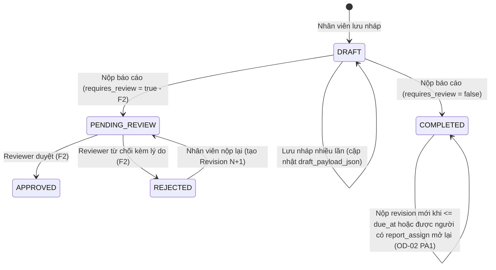

# F0 — Deliverable B: Product Contracts & Locked Owner Decisions (`F0-product-contracts-and-open-decisions.md`)

> [!IMPORTANT]
> - **Baseline khảo sát ban đầu:** `8bf16afe9360e5eebe0dd9183c8ef9d85fc39b0c` (`8bf16afe`)
> - **Delta Review & Effective Baseline (`origin/main` sau PR #97 R2.2 Visual Completion):** `bd67c4b88106d6147b1fd043fadc4326366a0e69` (`bd67c4b` — 129 migrations, 0 thay đổi lên DB/auth/navigation contract).
> - **Ngày Product Owner phê duyệt khóa hợp đồng F0 (`OD-01` → `OD-08`):** `21/10/2026` (`Status: OWNER LOCKED`).
> - Tài liệu này phân biệt rõ 4 trạng thái thông tin:
>   - **FACT:** Đã xác minh trong codebase/database hoặc trong Master Plan §0.1 ([`./master-plan.md`](./master-plan.md#L14-L33)).
>   - **OWNER LOCKED:** Quyết định nghiệp vụ và kiến trúc đã được Product Owner chính thức phê duyệt khóa ngày `21/10/2026` cho F1/F1.5/F2/F3.
>   - **PERFORMANCE TARGET / HYPOTHESIS TO VERIFY:** Mục tiêu hiệu năng hoặc ước lượng dung lượng chưa đo thực nghiệm ở F0, phải được kiểm chứng bằng benchmark tự động ở `F1.5-WP3` / `F1.5-WP4`.
>   - **OUT OF SCOPE:** Thuộc các phase sau hoặc ngoài phạm vi F1/F1.5.

---

## 1. Hợp đồng Form Builder (`schema_json` & Versioning)

### 1.1. Tập kiểu trường cho MVP F1 — 8 Kiểu Trường Cơ bản (`OD-08 = PA3` OWNER LOCKED)

Mỗi phiên bản mẫu báo cáo (`work_report_template_versions`) chứa một mảng `sections` và danh sách `fields`. Theo quyết định `OD-08 = PA3` (`OWNER LOCKED`, ngày `21/10/2026`), registry `field_type` trong F1/F1.5 chỉ gồm đúng **8 kiểu dữ liệu cơ bản (core field types)**:

| # | `field_type` | Trạng thái | Kiểu giá trị JSON | Cho phép làm Metric (`is_metric`)? | Cho phép làm Dimension / Filter (`is_dimension`)? | Quy tắc Validation cấu hình được |
|---|---|---|---|---|---|---|
| 1 | `text` | **Core F1 (LOCKED)** | `string` (1 dòng) | Không (chỉ `COUNT_VALID` nếu bắt buộc) | Không | `required` (`boolean`), `min_length` (`0..500`), `max_length` (`1..500`), `pattern_preset` (`none` \| `code` \| `phone` \| `email`) |
| 2 | `textarea` | **Core F1 (LOCKED)** | `string` (nhiều dòng) | Không | Không | `required` (`boolean`), `min_length` (`0..4000`), `max_length` (`1..4000`) |
| 3 | `integer` | **Core F1 (LOCKED)** | `number` (số nguyên an toàn) | **Có** (`SUM`, `AVG`, `MIN`, `MAX`, `COUNT_VALID`) | Không | `required` (`boolean`), `min_value`, `max_value`, `allow_zero` (mặc định `true`) |
| 4 | `decimal` | **Core F1 (LOCKED)** | `number` (tối đa 4 chữ số thập phân, lưu DB `numeric(18,4)`) | **Có** (`SUM`, `AVG`, `MIN`, `MAX`, `COUNT_VALID`) | Không | `required` (`boolean`), `min_value`, `max_value`, `decimal_places` (`1..4`), `allow_zero` |
| 5 | `date` | **Core F1 (LOCKED)** | `string` (`YYYY-MM-DD`) | Không | Có (ở F3 nếu cần lọc theo ngày sự kiện) | `required` (`boolean`), `min_date_rule` (`any` \| `within_period` \| `not_future`) |
| 6 | `boolean` | **Core F1 (LOCKED)** | `boolean` (`true` / `false`) | **Có** (`TRUE_COUNT`, `TRUE_RATE`) | **Có** | `required` (`boolean`), `default_value` (`true` \| `false` \| `null`) |
| 7 | `single_select` | **Core F1 (LOCKED)** | `string` (`option_key`) | **Có** (breakdown đếm theo từng `option_key`) | **Có** (F1.5/F3 filter & group-by) | `required` (`boolean`), `options` (mảng `{ option_key, label, active, sort_order }`, tối đa 50 lựa chọn) |
| 8 | `multi_select` | **Core F1 (LOCKED)** | `string[]` (mảng `option_key` duy nhất) | **Có** (đếm số báo cáo chứa `option_key` qua `COUNT(DISTINCT submission_id)`) | **Có** (F3 filter `contains`) | `required` (`boolean`), `min_selected`, `max_selected`, `options` (tối đa 50 lựa chọn) |

**Các loại trường ĐỂ SAU (OUT OF SCOPE cho F1/F1.5):**
- Trường tham chiếu danh mục dự án / chiều phân tích dự án (`OD-08 = PA3` `OWNER LOCKED`: không triển khai ở F1/F1.5, không chuẩn bị framework trước; nếu sau này Owner yêu cầu sẽ bổ sung bằng migration forward-only ở phase được phê duyệt).
- Upload file/ảnh đính kèm, chữ ký tay (F5).
- Bảng con lặp (nested repeater / sub-table — F5).
- Biểu thức tính toán tự do do người dùng tự gõ công thức JS/SQL (F5).
- Conditional logic ẩn/hiện nhiều tầng phức tạp (F5).

### 1.2. Cấu trúc Metadata của từng Field & Mẫu Nghiệp vụ Thực tế Duy nhất ở F1/F1.5 (`OD-01` OWNER LOCKED)

Không bao giờ dùng `label` hiển thị làm định danh lưu trữ. Mỗi field trong `schema_json` có hợp đồng:

```json
{
  "field_key": "workers_started",
  "section_key": "daily_kpi",
  "sort_order": 30,
  "label": "NLĐ đi làm",
  "description": "Số người lao động thực tế nhận việc trong ngày báo cáo",
  "field_type": "integer",
  "required": true,
  "default_value": 0,
  "validation": {
    "min_value": 0,
    "max_value": 10000
  },
  "options": null,
  "is_metric": true,
  "metric_spec": {
    "metric_key": "workers_started",
    "unit": "người",
    "aggregations": ["SUM", "AVG", "COUNT_VALID"],
    "null_policy": "EXCLUDE_FROM_AVG",
    "zero_policy": "INCLUDE_AS_ZERO",
    "compatible_group": "recruitment_daily_workers_started_v1"
  },
  "is_dimension": false
}
```

- **Quy tắc bất biến của `field_key` và `metric_key`:**
  - Định dạng chuẩn: `^[a-z][a-z0-9_]{1,63}$` (snake_case).
  - `field_key` là khóa duy nhất trong một `template_version` và là key trong `submission_payload_json`.
  - `metric_key` định danh ý nghĩa thống kê xuyên suốt các version của cùng một mẫu báo cáo.
- **Mẫu nghiệp vụ thực tế ở lát cắt F1/F1.5 (`OD-01` OWNER LOCKED):**
  - Chỉ sử dụng **Mẫu #1: Báo cáo công việc tuyển dụng ngày** (`calls_made`, `interested_candidates`, `workers_started`, `notes`) đã được định nghĩa tại Master Plan §1.3 & §11.1 ([`./master-plan.md`](./master-plan.md#L315-L324)).
  - Không tự tạo Mẫu nghiệp vụ #2 khi chưa có biểu mẫu thực tế do Product Owner cung cấp.
  - Các kiểu trường còn lại trong 8 kiểu trường core (`decimal`, `date`, `boolean`, `single_select`, `multi_select`) và các chu kỳ khác (`WEEKLY`, `MONTHLY`, `ONCE`) vẫn được kiểm thử đầy đủ bằng **technical fixtures** trong suite test tự động, không mô tả chúng là mẫu nghiệp vụ thực tế.

### 1.3. Vòng đời Mẫu & Quy tắc Versioning (FACT + OWNER LOCKED)

- **Vòng đời Template (`work_report_templates.status`):**
  - `DRAFT`: Mới khởi tạo, chưa có version nào được publish.
  - `ACTIVE`: Đã có ít nhất 1 `template_version` ở trạng thái `PUBLISHED`.
  - `ARCHIVED`: Ngừng giao mới; mọi lịch sử nghĩa vụ, bài nộp và số liệu thống kê F1.5/F3 vẫn tra cứu bình thường.
- **Vòng đời Phiên bản Mẫu (`work_report_template_versions.status`):**
  - `DRAFT` → `PUBLISHED` → `ARCHIVED`.
  - **Một khi đã chuyển sang `PUBLISHED`, `schema_json`, `metric_contract_json` và `requires_review` của `template_version` đó là BẤT BIẾN (immutable — chặn sửa bằng trigger DB).**
- **Điều gì xảy ra khi sửa mẫu đã có submission?**
  1. Admin bấm **"Tạo phiên bản mới (Clone to Draft v{N+1})"** từ version `v{N}` đang `PUBLISHED`.
  2. Các nghĩa vụ (`work_report_obligations`) và bài nộp (`work_report_submissions`) đã phát sinh ở kỳ cũ vẫn giữ nguyên khóa ngoại `template_version_id = v{N}`.
  3. Khi Admin `PUBLISH` phiên bản `v{N+1}`:
     - Các kỳ báo cáo **chưa mở / phát sinh từ ngày hiệu lực của version mới** sẽ dùng `v{N+1}`.
     - Các kỳ đang mở hoặc đã đóng của `v{N}` vẫn nhập/đọc/validate theo `v{N}`.
- **Ảnh hưởng của việc thêm, sửa, xóa, đổi kiểu field giữa `v{N}` và `v{N+1}`:**

| Thay đổi ở `v{N+1}` | Quy tắc kiểm tra khi Publish `v{N+1}` | Tác động tới báo cáo cũ & tổng hợp liên kỳ |
|---|---|---|
| Sửa `label`, `description`, thứ tự hiển thị của field giữ nguyên `field_key` & `metric_key` | Cho phép giữ nguyên `metric_key` nếu `field_type` và `unit` không đổi | Cộng gộp (`SUM`/`AVG`) xuyên suốt `v{N}` và `v{N+1}` liền mạch |
| Thêm field mới (`new_field_key`) | Hợp lệ | Báo cáo cũ ở `v{N}` không có field này (không tính vào `COUNT_VALID` hay mẫu số `AVG` của `new_field_key`) |
| Ẩn/bỏ một field cũ ở `v{N+1}` | Hợp lệ | Dữ liệu cũ ở `v{N}` vẫn hiển thị nguyên vẹn khi xem snapshot `v{N}` và vẫn được tổng hợp cho các kỳ thuộc `v{N}` |
| Đổi `field_type` (VD: `text` → `integer`) hoặc đổi `unit` (VD: `người` → `giờ`) hoặc đổi ý nghĩa nghiệp vụ | **DB/Server chặn dùng lại cùng `metric_key` hoặc cùng `field_key` khác kiểu dữ liệu**; bắt buộc đặt `field_key`/`metric_key` mới | Tránh tuyệt đối việc cộng nhầm hai đại lượng khác đơn vị/ý nghĩa giữa hai version |

---

## 2. Hợp đồng Vòng đời Báo cáo (Submission Lifecycle) & Duyệt tùy chọn

### 2.1. Tách biệt Trạng thái Nghĩa vụ (Obligation State) và Trạng thái Bài nộp (Submission State) (FACT + OWNER LOCKED)

1. **Bảng `work_report_obligations` quản lý nghĩa vụ phải nộp** (1 dòng cho mỗi `assignee_app_user_id × template_id × period_key`):
   - `obligation_status` lưu trữ trạng thái quản trị:
     - `ACTIVE`: Nghĩa vụ có hiệu lực.
     - `EXEMPTED`: Được miễn nghĩa vụ trong kỳ này (bắt buộc có `status_reason_id` + người miễn + audit theo `OD-03 = PA1`; **loại khỏi mẫu số phải nộp**).
     - `CANCELLED`: Đã hủy do thu hồi assignment trước khi kỳ kết thúc hoặc nhân sự nghỉ việc trước kỳ (có audit; **loại khỏi mẫu số phải nộp**).
   - `fulfillment_state` (trạng thái hoàn thành nghĩa vụ, tính toán nhất quán từ `obligation` + `current_submission` + thời gian hiện tại `as_of` theo múi giờ `Asia/Ho_Chi_Minh`):
     - `UPCOMING`: Chưa nộp (`current_submission` chưa nộp) VÀ `as_of < period_start`.
     - `DUE`: Chưa nộp VÀ `period_start <= as_of <= due_at`.
     - `OVERDUE_MISSING`: Chưa nộp VÀ `as_of > due_at`.
     - `SUBMITTED_PENDING_REVIEW` (chỉ khi `requires_review = true`): Đã nộp nhưng đang chờ duyệt.
     - `REJECTED_ACTION_REQUIRED` (chỉ khi `requires_review = true`): Đã nộp nhưng bị từ chối, cần nộp lại.
     - `COMPLETED_ON_TIME`: Đã hoàn tất hợp lệ (`COMPLETED` nếu không cần duyệt, hoặc `APPROVED` nếu cần duyệt) VÀ `first_submitted_at <= due_at`.
     - `COMPLETED_LATE`: Đã hoàn tất hợp lệ VÀ `first_submitted_at > due_at`.

2. **Bảng `work_report_submissions` quản lý bài nộp thực tế** (quan hệ `1:1` với `obligation_id` cho bài nộp gốc, kèm chuỗi `work_report_submission_revisions` bất biến):
   - **Trường hợp Mặc định (`requires_review = false` — đã chốt tại Master Plan §0.1 #2, [`./master-plan.md`](./master-plan.md#L19-L20)):**
     - `DRAFT` → nhân viên bấm Nộp → **`COMPLETED`**.
     - Không đi qua hàng đợi duyệt của Team Leader. Ngay khi chuyển sang `COMPLETED`, các chỉ tiêu định lượng của revision hiện hành trong `work_report_metric_values` được gán `is_current_revision = true, is_final = true, is_provisional = false, is_eligible = true`.
   - **Quy tắc Sửa / Nộp bổ sung sau khi `COMPLETED` (`OD-02 = PA1` & `OD-05 = PA1` OWNER LOCKED):**
     - Trước hoặc đúng `due_at` (`now() <= due_at`): nhân viên được phép tạo revision mới (`revision_no = k + 1`), không ghi đè revision cũ.
     - Sau `due_at` (`now() > due_at`): nhân viên **không được tự sửa**. Chỉ người có `report_assign` trong đúng scope (`@ all` hoặc `@ team`) mới được mở lại cho phép nộp bản sửa đổi, bắt buộc nhập lý do và ghi audit; khi nhân viên nộp revision mới sau `due_at`, hệ thống giữ nguyên `first_submitted_at` (không biến bài nộp đúng hạn ban đầu thành nộp muộn) và gán `has_post_deadline_amendment = true` kèm audit.
   - **Trường hợp Mẫu Bật Duyệt (`requires_review = true` — triển khai workflow ở F2):**
     - `DRAFT` → nhân viên bấm Nộp → **`PENDING_REVIEW`** (chỉ tiêu có `is_current_revision = true, is_provisional = true, is_final = false, is_eligible = true`).
     - Reviewer hợp lệ (`report_review` trong scope, `reviewer_user_id <> submitted_by_user_id`) quyết định:
       - Duyệt → **`APPROVED`** (chỉ tiêu chuyển thành `is_current_revision = true, is_final = true, is_provisional = false, is_eligible = true`).
       - Từ chối (bắt buộc nhập lý do) → **`REJECTED`** (chỉ tiêu của revision bị từ chối chuyển thành `is_current_revision = true, is_provisional = false, is_final = false, is_eligible = false`).
     - Nhân viên sửa và nộp lại sau khi `REJECTED`: tạo `work_report_submission_revisions` mới (`revision_no = k + 1`), cập nhật `current_revision_id` trên `work_report_submissions`, hạ revision cũ về `is_current_revision = false, is_eligible = false`, và chèn metric của revision mới ở trạng thái `PENDING_REVIEW` (`is_current_revision = true, is_provisional = true, is_final = false, is_eligible = true`).



### 2.2. Chống đếm trùng khi sửa / nộp lại báo cáo (OWNER LOCKED)

- Mỗi `obligation_id` chỉ có **tối đa 01 dòng** trong `work_report_submissions` (`UNIQUE (obligation_id)`).
- Mỗi lần nhân viên nộp hoặc nộp lại/bổ sung (amendment), hệ thống **không tạo dòng `work_report_submissions` thứ hai** và **không bao giờ ghi đè dòng revision cũ**, mà:
  1. Thêm một dòng mới vào `work_report_submission_revisions` (`submission_id`, `revision_no`, `payload_json`, `created_by_user_id`, `created_at`).
  2. Cập nhật con trỏ `current_revision_id` trên `work_report_submissions` (kèm tăng `version` OCC).
  3. Trong cùng một DB transaction, đánh dấu toàn bộ dòng `work_report_metric_values` của revision cũ là `is_current_revision = false, is_provisional = false, is_final = false, is_eligible = false`, và chỉ chèn `is_current_revision = true` (kèm `is_eligible = (is_final OR is_provisional)`) cho revision mới.
- Nhờ vậy, mọi truy vấn tổng hợp F1.5/F3 chỉ lọc `WHERE is_eligible = true AND is_final = true` (chế độ mặc định `final`) hoặc `WHERE is_eligible = true` (chế độ `provisional_included` ở F2) — **không bao giờ đếm trùng chỉ tiêu dù nhân viên sửa hay nộp lại bao nhiêu lần**.

---

## 3. Hợp đồng Reporting Obligations — Ai phải nộp? (10 Kịch bản Nghiệp vụ)

### 3.1. So sánh Kiến trúc: Snapshot nghĩa vụ theo kỳ vs Tính động từ Team Membership (OWNER LOCKED)

| Tiêu chí | Phương án A: Tính động từ `recruiter_team_memberships` lúc xem Dashboard | Phương án B (ĐÃ KHÓA): Bảng `work_report_obligations` Snapshot theo từng kỳ |
|---|---|---|
| **Giữ lịch sử khi đổi nhóm / nghỉ việc** | **Sai lệch lịch sử:** Khi nhân viên chuyển từ Team A sang Team B ở tháng 11, mở lại báo cáo tháng 10 của Team A sẽ mất nghĩa vụ của người đó (hoặc nhảy sang Team B). | **Chính xác tuyệt đối:** Mỗi dòng `work_report_obligations` lưu cứng `snapshot_team_id` tại thời điểm kỳ báo cáo phát sinh. |
| **Xử lý miễn nộp / nghỉ phép cá nhân** | Rất phức tạp, phải tạo bảng ngoại lệ rời rồi `LEFT JOIN` trừ lùi mỗi lần tính mẫu số. | Tường minh trên dòng `obligation` (`obligation_status = 'EXEMPTED'`, `status_reason_id`, `status_changed_by_user_id`). |
| **Xác định đúng hạn / nộp trễ / quá hạn** | Phải tính lại công thức hạn nộp động cho từng người × từng ngày trên mọi câu query. | Mỗi `obligation` có sẵn `period_start_date`, `period_end_date`, `due_at` (`timestamptz`) có index (`PERFORMANCE TARGET`: truy vấn `COUNT` theo kỳ/nhóm `< 5ms` trên PostgreSQL — sẽ kiểm chứng ở `F1.5-WP3`). |
| **Chi phí lưu trữ** | Không tốn bảng obligation. | Nhỏ (`HYPOTHESIS TO VERIFY`: 50 nhân sự × 365 ngày = 18.250 dòng/năm/mẫu, ước tính `~4 MB/năm` kể cả index — sẽ đo thực tế ở `F1.5-WP3`). |

### 3.2. Giải quyết 10 bài toán nghiệp vụ của Reporting Obligations (OWNER LOCKED)

1. **Giao cho cá nhân, team hoặc tập người dùng được chọn (`OD-03 = PA1` OWNER LOCKED):**
   - `work_report_assignments` hỗ trợ `target_kind IN ('USER', 'TEAM', 'USER_SET')`:
     - `USER`: Giao đích danh 1 `target_user_id` trên `work_report_assignments` (`target_team_id IS NULL`).
     - `TEAM`: Giao cho 1 `target_team_id` đang active (`target_user_id IS NULL`); khi sinh nghĩa vụ cho kỳ `P`, hệ thống lấy danh sách thành viên hiện hành của `target_team_id` (qua `recruiter_team_memberships` + `direct_entry_app_user_recruiter_links` + `direct_entry_app_users` có `is_current = true` và `enabled = true`).
     - `USER_SET`: Giao cho tập người dùng được chọn thông qua **bảng chuẩn hóa `public.work_report_assignment_targets` (`assignment_id`, `target_user_id`, `UNIQUE (assignment_id, target_user_id)`)**, trong khi `target_user_id IS NULL AND target_team_id IS NULL` trên `work_report_assignments`. Nếu người giao chỉ có `report_assign @ team` và trong `USER_SET` có bất kỳ người nhận nào ngoài nhóm hiện hành của mình, toàn bộ transaction bị từ chối (`403 WORK_REPORT_SCOPE_DENIED`).
2. **Cách tạo nghĩa vụ phải nộp theo kỳ / ngày / hạn nộp:**
   - Hỗ trợ chu kỳ `frequency IN ('DAILY', 'WEEKLY', 'MONTHLY', 'ONCE')`.
   - Hàm SQL idempotent `public.work_report_ensure_obligations_for_window(p_template_id, p_from_date, p_to_date)` được gọi ngay khi tạo/cập nhật assignment và gọi on-demand (`INSERT ... ON CONFLICT DO NOTHING`) khi mở danh sách việc cần làm / dashboard kỳ hiện tại.
3. **Phân biệt báo cáo bắt buộc (`MANDATORY`) và tùy chọn (`OPTIONAL`):**
   - Cột `is_mandatory boolean not null default true` trên `work_report_assignments` và `work_report_obligations`.
   - Báo cáo `MANDATORY` nằm trong mẫu số `due_count`; báo cáo `OPTIONAL` không tính vào mẫu số bắt buộc phải nộp và không bị gắn `OVERDUE_MISSING`.
4. **Cách tính Chưa nộp, Đã nộp, Nộp muộn, Miễn nghĩa vụ và Hoàn thành:**
   - Chỉ xét các nghĩa vụ có `is_mandatory = true` và `obligation_status = 'ACTIVE'`:
     - **Tổng nghĩa vụ phải hoàn thành (Mẫu số — `due_count`):** `COUNT(*)` các dòng `ACTIVE` & `is_mandatory = true`.
     - **Đã hoàn thành (`completed_count`):** Số dòng có bài nộp đạt trạng thái hoàn tất (`COMPLETED` với mẫu không duyệt; `APPROVED` với mẫu có duyệt).
     - **Nộp muộn (`late_submitted_count`):** Tập con của nhóm đã nộp có `first_submitted_at > due_at` (không cộng thêm vào mẫu số!).
     - **Chưa nộp nhưng còn hạn (`pending_due_count`):** Chưa có bài nộp VÀ `now() <= due_at`.
     - **Quá hạn chưa nộp (`overdue_missing_count`):** Chưa có bài nộp VÀ `now() > due_at`.
     - **Miễn nghĩa vụ (`exempted_count`):** `obligation_status = 'EXEMPTED'` (hiển thị riêng để giải trình, không nằm trong `due_count`).
     - **Tỷ lệ hoàn thành (`completion_rate`):**
       $$\text{completion\_rate} = \begin{cases} \text{null} & \text{nếu } \text{due\_count} = 0 \\ \text{ROUND}\left(\frac{\text{completed\_count}}{\text{due\_count}} \times 100, 2\right) & \text{nếu } \text{due\_count} > 0 \end{cases}$$
5. **Xử lý người được thêm vào team giữa kỳ, chuyển team, nghỉ hoặc bị thu hồi quyền:**
   - **Thêm vào team giữa kỳ:** Không tự động tạo nợ quá hạn (`OVERDUE_MISSING`) cho các kỳ đã qua trước ngày nhân viên vào team.
   - **Chuyển từ Team A sang Team B:** Các nghĩa vụ đã phát sinh ở các kỳ thuộc Team A giữ nguyên `snapshot_team_id = Team A`. Từ kỳ mới sau khi chuyển, nghĩa vụ mới sinh ra mang `snapshot_team_id = Team B`.
   - **Tài khoản bị vô hiệu hóa (`enabled = false`) hoặc nghỉ việc:** Tự động chuyển các nghĩa vụ **chưa nộp của kỳ tương lai** (`period_start_date > today_hcm`) sang `obligation_status = 'CANCELLED'` (kèm lý do hệ thống).
6. **Giữ lịch sử chính xác khi cơ cấu team thay đổi:**
   - Mỗi dòng `work_report_obligations` lưu `snapshot_team_id`, `snapshot_team_code`, `snapshot_team_display_name` tại thời điểm sinh nghĩa vụ, và mỗi dòng `work_report_submissions` lưu `submitted_team_id` tại thời điểm nộp.
7. **Xử lý nhiều submission cho cùng một nghĩa vụ:**
   - DB chặn cứng `UNIQUE (obligation_id)` trên `work_report_submissions`. Mọi lần lưu nháp/nộp lại đều đi vào cùng `submission_id` và sinh `work_report_submission_revisions` tuần tự (`revision_no = 1, 2, ...`).
8. **Múi giờ và ranh giới kỳ báo cáo:**
   - Múi giờ chuẩn duy nhất: `Asia/Ho_Chi_Minh` (`UTC+07:00`).
9. **Xử lý sửa hoặc nộp lại báo cáo (`OD-05 = PA1` OWNER LOCKED):**
   - `is_late` tính theo `first_submitted_at > due_at`. Các revision sửa đổi nộp sau `due_at` (khi được người có `report_assign` mở lại theo `OD-02 = PA1`) không làm thay đổi trạng thái đúng hạn ban đầu mà ghi nhận `has_post_deadline_amendment = true` và ghi audit.
10. **Bảo đảm cùng một người không bị đếm hai lần trong một nghĩa vụ (Overlapping Assignments):**
    - Ràng buộc duy nhất trên bảng nghĩa vụ là **`UNIQUE (template_id, assignee_app_user_id, period_key)`** (thứ tự ưu tiên: `USER` > `USER_SET` > `TEAM`).

---

## 4. Nhật ký Quyết định của Product Owner (`OD-01` → `OD-08` — `OWNER LOCKED`)

Ngày phê duyệt: **`21/10/2026`**. Toàn bộ 8 quyết định dưới đây đã được Product Owner chính thức khóa (`Status: OWNER LOCKED`):

| Mã | Trạng thái | Ngày phê duyệt | Phương án đã khóa | Nội dung hợp đồng bắt buộc thực thi |
|---|---|---|---|---|
| **OD-01** | `OWNER LOCKED` | `21/10/2026` | **Chỉ dùng Mẫu #1 cho lát cắt nghiệp vụ F1/F1.5** | - Lát cắt F1/F1.5 đầu tiên chỉ dùng **Mẫu #1: Báo cáo công việc tuyển dụng ngày** ([`./master-plan.md`](./master-plan.md#L315-L324)).<br>- Không tự tạo Mẫu #2 khi chưa có biểu mẫu thực tế do Owner cung cấp.<br>- Các field type và chu kỳ khác được kiểm tra bằng **technical fixtures**, không mô tả chúng là mẫu nghiệp vụ thực tế. |
| **OD-02** | `OWNER LOCKED` | `21/10/2026` | **PA1 LOCKED** | - Cho phép nhân viên tạo revision mới trước hoặc đúng `due_at` (`now() <= due_at`).<br>- Sau `due_at`, nhân viên không được tự sửa.<br>- Người có `report_assign` trong đúng scope (`@ all` hoặc `@ team`) được mở lại nghĩa vụ/bài nộp, bắt buộc nhập lý do và ghi audit.<br>- Không bao giờ ghi đè revision cũ (`work_report_submission_revisions` là append-only). |
| **OD-03** | `OWNER LOCKED` | `21/10/2026` | **PA1 LOCKED** | - `report_assign @ all` được giao và miễn nghĩa vụ (`EXEMPT`) toàn công ty.<br>- Team Leader có `report_assign @ team` được giao và miễn nghĩa vụ trong current managed team.<br>- `EXEMPT` bắt buộc có `reason` và ghi audit.<br>- `USER_SET` (`work_report_assignment_targets`) có bất kỳ người nhận nào ngoài scope thì từ chối toàn bộ transaction (`403 WORK_REPORT_SCOPE_DENIED`). |
| **OD-04** | `OWNER LOCKED` | `21/10/2026` | **PA1 LOCKED** | - Khi bổ nhiệm Team Leader (`direct_entry_apply_team_leader_mutation`), tự cấp trong `scope = team`:<br>  - **F1/F1.5:** `report_view`, `report_analytics_view`, `report_assign`.<br>  - **F2:** thêm `report_review`.<br>  - **F3:** thêm `report_export`.<br>- Thu hồi tương ứng khi bãi nhiệm Team Leader.<br>- Không tự cấp `report_form_manage` hoặc `report_delegate`.<br>- Không hardcode theo role/title; dùng current assignment và current grants. |
| **OD-05** | `OWNER LOCKED` | `21/10/2026` | **PA1 LOCKED** | - `is_late` dựa trên `first_submitted_at` so với `due_at` (`first_submitted_at > due_at`).<br>- Revision sau hạn không đổi kết quả đúng hạn ban đầu.<br>- Ghi `has_post_deadline_amendment = true` và ghi audit. |
| **OD-06** | `OWNER LOCKED` | `21/10/2026` | **PA2 LOCKED (XLSX ở F3)** | - **F1.5 không có XLSX.**<br>- `report_export`, RPC/API export (`work_report_export_data`, `POST /api/work-reports/analytics/export`), `AG-14` và `SEC-WR-04` thuộc **F3 (`F3-WP3`)**.<br>- F1/F1.5 chỉ có KPI tuân thủ, metric summary, breakdown, drill-down và source evidence. |
| **OD-07** | `OWNER LOCKED` | `21/10/2026` | **PA1 LOCKED** | - Mở rộng `direct_entry_capability_grants_capability_check` và TypeScript `CAPABILITIES` hiện tại.<br>- Không tạo bảng grant hoặc policy engine mới.<br>- Token count cố định:<br>  - **F1/F1.5:** DB CHECK **`27`**, TypeScript **`23`**.<br>  - **F2:** DB CHECK **`29`**, TypeScript **`25`**.<br>  - **F3:** DB CHECK **`30`**, TypeScript **`26`**.<br>- Giữ 4 retired legacy DB tokens (`pii_view`, `pii_export`, `payment_view`, `payment_edit`), không đưa lại vào TypeScript. |
| **OD-08** | `OWNER LOCKED` | `21/10/2026` | **PA3 LOCKED (Chỉ 8 core field types)** | - **F1/F1.5 chỉ có 8 core field types** (`text`, `textarea`, `integer`, `decimal`, `date`, `boolean`, `single_select`, `multi_select`).<br>- Không triển khai trường tham chiếu dự án, chiều phân tích dự án hoặc bộ lọc dự án ở F1/F1.5.<br>- Đã loại bỏ cột/tham số dự án khỏi schema, API, analytics contract và work packages của F1/F1.5.<br>- Nếu sau này Owner yêu cầu, bổ sung bằng migration forward-only ở phase được phê duyệt; không chuẩn bị framework trước. |
